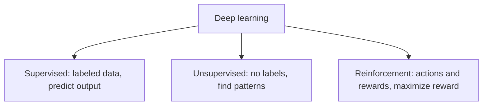

**In simple words:** deep learning models are mainly divided into three types based on how they learn from data: supervised learning (with answers), unsupervised learning (without answers) and reinforcement learning (learning by experience). <Cite id="class-dl-chp1" loc="slide 25" />

**1. Supervised learning.** The model learns from **labeled data**: the input comes with the correct output, and it learns a mapping from input (X) to output (Y). *Example:* give a photo of a cat and say "this is a cat"; labeled cat and dog images pass through a deep neural network, which predicts the label. *Use cases:* image classification, spam detection in emails, handwriting recognition, object detection, medical diagnosis. *Networks:* CNN, RNN, LSTM. <Cite id="class-dl-chp1" loc="slide 25" /> <Cite id="class-dl-m1" loc="p. 36" />

**2. Unsupervised learning.** The model learns from data **without labels** and finds patterns or groups by itself. *Example:* many animal photos without names; the model groups similar ones together. *Use cases:* customer segmentation, grouping similar products, feature learning, dimensionality reduction, anomaly detection. *Networks:* autoencoders, deep belief networks, GANs. <Cite id="class-dl-chp1" loc="slide 25" /> <Cite id="class-dl-m1" loc="p. 36" />

**3. Reinforcement learning.** The model learns by **doing actions and getting rewards or punishments**; it tries to maximize rewards over time. The agent observes the state, takes an action, receives a reward and updates its policy. *Example:* a robot learning to walk; it tries, falls and learns from feedback. *Use cases:* game playing (chess, Go), robotics, self-driving cars. <Cite id="class-dl-chp1" loc="slide 25" /> <Cite id="class-dl-m1" loc="p. 36" />

| Type | Learns from | Needs labels? | Main goal |
|---|---|---|---|
| Supervised | Labeled data | Yes | Predict output |
| Unsupervised | Unlabeled data | No | Find patterns or groups |
| Reinforcement | Actions and feedback | No | Maximize rewards |

**Conclusion:** the three classes differ by the type of data and feedback used for learning: supervised learns with help, unsupervised finds by itself, reinforcement learns by doing. <Cite id="class-dl-m1" loc="p. 36" />
