**In simple words:** CNN ek deep learning model hai jo convolutional filters se images ke spatial features khud seekhta hai. Convolution aur pooling layers features dhundti hain; flatten aur fully connected layers class decide karti hain. <Cite id="class-dl-chp4" loc="slide 5" />

**Definition:** CNN ek type ka deep neural network hai jo specially images aur dusre grid-like data ke liye bana hai.

```mermaid
%% caption: Class ka basic CNN, har step ke baad data ki shape ke saath. Left part features nikalta hai; right part classify karta hai.
flowchart LR
  A["Input 32×32×3"] --> B["Conv + ReLU: 28×28×32"]
  B --> C["Max pool: 14×14×32"]
  C --> D["Conv + ReLU: 10×10×64"]
  D --> E["Max pool: 5×5×64"]
  E --> F["Flatten: 1600"]
  F --> G["Fully connected: 128"]
  G --> H["Softmax: Dog 0.80"]
```

**Ye kyun zaroori hai:** fully connected network mein parameters bahut zyada ho jaate hain (28×28 image aur 100 neurons ko 784 × 100 = 78,400 weights chahiye) aur spatial information kho jaati hai. CNN local connectivity, weight sharing aur pooling use karta hai, isliye use bahut kam parameters chahiye. <Cite id="class-dl-chp4" loc="slide 5" />

**Layers, step by step** <Cite id="class-dl-chp4" loc="slide 28" />

1. **Input:** image pixel values ke roop mein.
2. **Convolution + ReLU:** filters (learnable weights ke chhote matrices) input par slide karte hain, multiply aur add karte hain, aur har ek ek feature map deta hai. Output size $= \lfloor (N - F + 2P)/S \rfloor + 1$. ReLU negative values ko 0 bana deta hai.
3. **Pooling:** max pooling har region ki sabse badi value rakhta hai aur size kam karta hai, lekin depth nahi.
4. **More convolution + ReLU aur pooling:** early layers edges seekhti hain, deeper layers curves aur object parts.
5. **Flatten:** 3D feature maps ko 1D vector mein badalta hai.
6. **Fully connected layer:** seekhe hue features ko combine karti hai.
7. **Softmax:** scores ko 0 aur 1 ke beech probabilities mein badalta hai (sum 1). Sabse high probability wali class prediction hai.

**CNN versus fully connected:** CNN local connections aur shared filter weights use karta hai, uske parameters bahut kam hain aur wo spatial structure preserve karta hai. <Cite id="class-dl-chp4" loc="slide 5" />

**Applications:** image classification, face recognition, object detection, medical image analysis. <Cite id="class-dl-chp4" loc="slide 67" />

**Conclusion:** local connectivity + weight sharing + pooling images se efficient feature learning dete hain.
