**In simple words:** convolutional neural network (CNN) images ke liye bana neural network hai. Har pixel ko har neuron se connect karne ki jagah ye chhote learned filters ko image par slide karta hai taaki local patterns mil sakein, pooling se result ko chhota karta hai, aur phir normal fully connected layers se classify karta hai. <Cite id="gfdl-ch9" />

**Definition:** CNN grid-jaise data (jaise images) ke liye network hai, jisme convolution aur pooling layers features nikalti hain aur fully connected layers unhe classify karti hain.

**Ye kyun zaroori hai:** fully connected network ko chhoti image ke liye bhi bahut saare weights chahiye, wo batata nahi ki kaunse pixels neighbours hain, aur har position par wahi pattern dobara seekhna padta hai. CNN puri image par chhote filters ko reuse karta hai. <Cite id="cs231n-cnn" />

**Kaise kaam karta hai, layer by layer**

1. **Input:** pixel values, height × width × colour channels ke roop mein.
2. **Convolution layer:** ek chhota filter image par slide karta hai, har position par multiply-and-add karta hai, aur ek feature map banata hai. Stride batata hai filter ek baar mein kitna jump karta hai; padding ek border jodta hai taaki size same rah sake. Bahut filters se bahut maps milte hain. Shuru ki layers edges dhoondhti hain; aage ki layers shapes aur object ke parts.
3. **ReLU:** har negative value ko 0 kar deta hai, jisse network non-linear patterns seekh sakta hai.
4. **Pooling layer:** har chhote block ki sabse badi value (max pooling) rakhti hai. Ye height aur width chhoti karti hai, channels same rakhti hai, aur iske weights nahi hote.
5. **Repeat:** deeper layers ke liye convolution, ReLU aur pooling ko dohraao.
6. **Flatten aur fully connected layers:** aakhri maps ek list of features ban jaate hain, jise fully connected layers combine karti hain.
7. **Output:** softmax har class ki ek probability deta hai. Training mein loss aur backpropagation se filters aur weights adjust hote hain. <Cite id="gfg-cnn" />

**Diagram**

```mermaid
%% caption: CNN ka architecture, har layer ke baad data ka shape (ek 32×32 colour image, do conv blocks). Notice karo size chhota hota hai aur maps ki sankhya badhti hai.
flowchart LR
  A["Input 32×32×3"] --> B["Conv 6 filters 5×5 + ReLU: 28×28×6"]
  B --> C["Max pool 2×2: 14×14×6"]
  C --> D["Conv 16 filters 5×5 + ReLU: 10×10×16"]
  D --> E["Max pool 2×2: 5×5×16"]
  E --> F["Flatten: 400"]
  F --> G["Fully connected"]
  G --> H["Softmax: class probabilities"]
```

**Ye design fully connected network se better kyun hai**

| Point | Fully connected | CNN |
|---|---|---|
| Connections | Every input to every neuron | Small local patch |
| Weight sharing | No | Yes, one filter is used everywhere |
| Number of weights | Very many | Few |
| 2D layout kept | No | Yes |

**Advantages:** seekhne ke liye kam weights, apne features khud seekhta hai, aur pattern image mein jahan bhi ho use dhoondh leta hai. **Disadvantages:** bahut labelled data aur GPU time chahiye; samajhna mushkil hai; apne aap rotation-invariant nahi hai.

**Applications:** image classification, object detection, face recognition, medical image analysis.

**Conclusion:** CNN ek feature extractor (convolution, ReLU, pooling) hai, uske baad ek classifier (fully connected layers aur softmax), aur images ke liye ye standard network hai. <Cite id="d2l-cnn-why" />

Exam mein English mein likho: "A CNN is a feature extractor (convolution, ReLU, pooling) followed by a classifier (fully connected layers and softmax)."
