**In simple words:** a CNN is a deep learning model that automatically learns spatial features from images using convolutional filters. Convolution and pooling layers find the features; flatten and fully connected layers decide the class. <Cite id="class-dl-chp4" loc="slide 5" />

**Definition:** a CNN is a type of deep neural network specially designed to work with images and other grid-like data.

```mermaid
%% caption: The basic CNN of the class with the data shape after each step. The left part extracts features; the right part classifies.
flowchart LR
  A["Input 32×32×3"] --> B["Conv + ReLU: 28×28×32"]
  B --> C["Max pool: 14×14×32"]
  C --> D["Conv + ReLU: 10×10×64"]
  D --> E["Max pool: 5×5×64"]
  E --> F["Flatten: 1600"]
  F --> G["Fully connected: 128"]
  G --> H["Softmax: Dog 0.80"]
```

**Why it is needed:** a fully connected network gives too many parameters (a 28×28 image with 100 neurons needs 784 × 100 = 78,400 weights) and loses spatial information. A CNN uses local connectivity, weight sharing and pooling, so it needs far fewer parameters. <Cite id="class-dl-chp4" loc="slide 5" />

**Layers, step by step** <Cite id="class-dl-chp4" loc="slide 28" />

1. **Input:** the image as pixel values.
2. **Convolution + ReLU:** filters (small matrices of learnable weights) slide over the input, multiply and add, and give one feature map each. Output size $= \lfloor (N - F + 2P)/S \rfloor + 1$. ReLU turns negative values into 0.
3. **Pooling:** max pooling keeps the largest value of each region and reduces size, but not depth.
4. **More convolution + ReLU and pooling:** early layers learn edges, deeper layers learn curves and object parts.
5. **Flatten:** converts the 3D feature maps into a 1D vector.
6. **Fully connected layer:** combines the learned features.
7. **Softmax:** converts scores to probabilities between 0 and 1 (sum 1). The class with the highest probability is the prediction.

**CNN versus fully connected:** a CNN uses local connections and shared filter weights, has much smaller parameters and preserves spatial structure. <Cite id="class-dl-chp4" loc="slide 5" />

**Applications:** image classification, face recognition, object detection, medical image analysis. <Cite id="class-dl-chp4" loc="slide 67" />

**Conclusion:** local connectivity + weight sharing + pooling give efficient feature learning from images.
