**In simple words:** a convolutional neural network (CNN) is a neural network for images. Instead of connecting every pixel to every neuron, it slides small learned filters over the image to find local patterns, shrinks the result with pooling, and then classifies with ordinary fully connected layers. <Cite id="gfdl-ch9" />

**Definition:** a CNN is a network for grid-like data such as images, in which convolution and pooling layers extract features and fully connected layers classify them.

**Why it is needed:** a fully connected network needs huge numbers of weights even for a small image, ignores which pixels are neighbours, and must learn the same pattern again at every position. A CNN reuses small filters across the whole image. <Cite id="cs231n-cnn" />

**How it works, layer by layer**

1. **Input:** the pixel values, as height × width × colour channels.
2. **Convolution layer:** a small filter slides over the image, does a multiply-and-add at each position, and writes one feature map. Stride is how far the filter jumps each time; padding adds a border so the size can stay the same. Many filters give many maps. Early layers find edges; deeper layers find shapes and object parts.
3. **ReLU:** sets every negative value to 0, which lets the network learn non-linear patterns.
4. **Pooling layer:** keeps the largest value (max pooling) of each small block. It makes the height and width smaller, keeps the channels, and has no weights.
5. **Repeat** convolution, ReLU and pooling for deeper layers.
6. **Flatten and fully connected layers:** the final maps become one list of features, which the fully connected layers combine.
7. **Output:** softmax gives one probability per class. Training uses a loss and backpropagation to adjust the filters and weights. <Cite id="gfg-cnn" />

**Diagram**

```mermaid
%% caption: Architecture of a CNN with the shape of the data after each layer (a 32×32 colour image, two conv blocks). Notice the size shrinks while the number of maps grows.
flowchart LR
  A["Input 32×32×3"] --> B["Conv 6 filters 5×5 + ReLU: 28×28×6"]
  B --> C["Max pool 2×2: 14×14×6"]
  C --> D["Conv 16 filters 5×5 + ReLU: 10×10×16"]
  D --> E["Max pool 2×2: 5×5×16"]
  E --> F["Flatten: 400"]
  F --> G["Fully connected"]
  G --> H["Softmax: class probabilities"]
```

**Why this design beats a fully connected network**

| Point | Fully connected | CNN |
|---|---|---|
| Connections | Every input to every neuron | Small local patch |
| Weight sharing | No | Yes, one filter is used everywhere |
| Number of weights | Very many | Few |
| 2D layout kept | No | Yes |

**Advantages:** few weights to learn, learns its own features, and detects a pattern wherever it appears in the image. **Disadvantages:** needs a lot of labelled data and GPU time; hard to interpret; not rotation-invariant by itself.

**Applications:** image classification, object detection, face recognition, medical image analysis.

**Conclusion:** a CNN is a feature extractor (convolution, ReLU, pooling) followed by a classifier (fully connected layers and softmax), and it is the standard network for images. <Cite id="d2l-cnn-why" />
