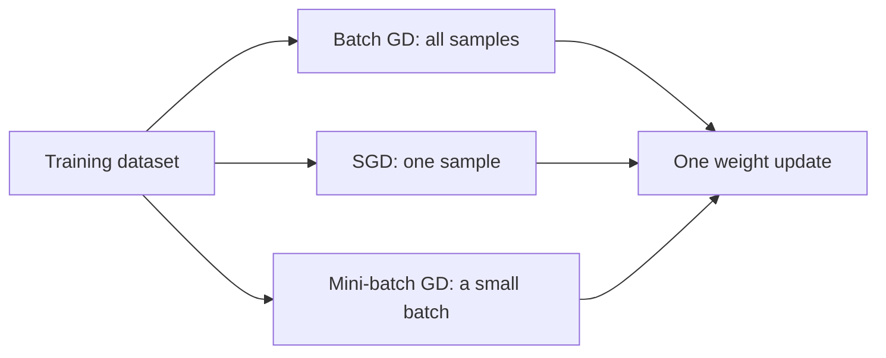

**In simple words:** gradient descent ke teeno types mein bas itna fark hai ki ek weight update se pehle kitna data use hota hai: sab (batch), ek sample (stochastic) ya chhota group (mini-batch). <Cite id="class-dl-m1" loc="p. 34" />

**Common idea:** gradient descent ek optimization algorithm hai jo loss kam karne ke liye weights aur biases update karta hai: $W_{new} = W_{old} - \eta \dfrac{\partial L}{\partial W}$. <Cite id="class-dl-chp2" loc="slide 63" />

**1. Batch gradient descent.** Ye weights update karne se pehle gradient calculate karne ke liye poora training dataset use karta hai (ek epoch mein ek update). Smooth, stable path deta hai par bade datasets ke liye slow hai aur high memory chahiye. <Cite id="class-dl-chp2" loc="slide 68" />

**2. Stochastic gradient descent (SGD).** Ye ek samay mein sirf ek training sample process karke weights update karta hai: sample pick karo, forward propagation, loss, backpropagation, turant update, agla sample. Formula ek sample ka loss use karta hai: $W_{new} = W_{old} - \eta\, \partial L_i / \partial W$. Ye fast hai, kam memory leta hai aur bahut bade datasets ke liye suitable hai, par path noisy (zig-zag) hai aur loss fluctuate karta hai. <Cite id="class-dl-chp2" loc="slides 68 to 70" />

**3. Mini-batch gradient descent.** Ye dataset ko mini-batches naam ke chhote groups mein baantta hai (batch size 16, 32, 64 ya 128) aur har mini-batch ke baad weights update karta hai: $W_{new} = W_{old} - \eta\, \partial L_{batch} / \partial W$. Batch GD se faster, SGD se zyada stable, GPUs support karta hai aur sabse commonly used version hai. Example: 100 fruits aur batch size 20 se ek epoch mein 5 updates. <Cite id="class-dl-chp2" loc="slides 71 to 73" />

| | Batch GD | SGD | Mini-batch GD |
|---|---|---|---|
| Uses | Entire dataset | One sample | Small batch |
| Speed | Slow | Very fast | Fast |
| Learning path | Smooth | Zig-zag | Slight zig-zag |
| Stability | Stable | Noisy | Balanced |
| Memory | High | Low | Medium |

**Conclusion:** mini-batch gradient descent speed aur stability ka sabse achha balance deta hai, isliye deep learning mein sabse zyada use hota hai.

Exam mein English mein likho: "Batch GD uses all samples, SGD uses one sample and mini-batch GD uses a small batch for one weight update."
