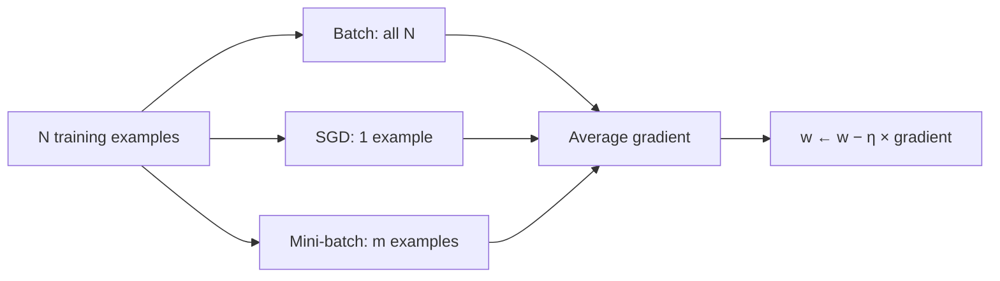

**In simple words:** gradient descent ka har type weights ko loss par downhill le jaata hai. Types is mein alag hain ki har step se pehle kitne training examples dekhe jaate hain (batch, stochastic, mini-batch), aur step ka size kaise adjust hota hai (momentum, Nesterov, AdaGrad, RMSProp, Adam).

**Definition:** gradient descent har weight ko thoda sa uske gradient (slope) ke ulte direction mein move karke loss kam karta hai: $w \leftarrow w - \eta\,\nabla L$, jahan $\eta$ learning rate (step size) hai aur $\nabla L$ loss ka gradient. <Cite id="gfdl-ch8" /> Poore dataset ka gradient accurate hota hai lekin nikalne mein slow; kam examples fast hote hain lekin noisy. Isi wajah se types hain.

**Worked example (ek step, har type ke liye same).**

<Sum>

<Given>

$w = 2$, $\eta = 0.1$, gradient $\nabla L = 4$.

</Given>

<Find>

naya weight.

</Find>

<Steps>

1. Step size $= \eta \times$ gradient $= 0.1 \times 4 = 0.4$.
2. Ise weight mein se ghatao, jo downhill le jaata hai: $2 - 0.4 = 1.6$.

</Steps>

<Answer>

naya $w = 1.6$.

</Answer>

<Box kind="verify">

Loss $L = w^2$ lo. Iska gradient $2w$ hai, jo $w = 2$ par $4$ hai, given value se match. Loss $L(2) = 4$ se $L(1.6) = 2.56$ ho jaata hai, aur $1.6$ par gradient $3.2$ hai, jo chhota hai, jaisa hona chahiye jab weight bottom ke paas pahunchta hai.

</Box>

</Sum>

**1. Batch gradient descent.** **Saare** $N$ examples dekho, unke gradients ka average lo, phir ek update karo (ek epoch mein 1 update).
*Advantages:* exact gradient, smooth aur stable path.
*Disadvantages:* bade data par slow aur zyada memory; poora pass khatam hone tak koi progress nahi.

**2. Stochastic gradient descent.** Data shuffle karo aur **har ek** example ke baad update karo (ek epoch mein $N$ updates).
*Advantages:* step bahut sasta, learning turant shuru, streaming data ke liye theek, aur noise shallow bad spots se nikalne mein madad kar sakta hai.
*Disadvantages:* noisy, zig-zag path; learning rate kam na ho to minimum ke paas weights hilte hain; GPU ka achha use nahi.

**3. Mini-batch gradient descent.** Data ko $m$ examples (aksar 32 se 256) ke random groups mein baanto aur har group ke baad update karo (ek epoch mein $N/m$ updates).
*Advantages:* SGD se kam noisy, batch se bahut fast, GPU par efficient.
*Disadvantages:* batch size ek aur setting hai; thoda noise bacha rehta hai.

**Conclusion:** mini-batch gradient descent accuracy aur speed mein balance rakhta hai, isliye almost saare deep networks ise use karte hain, aksar momentum ya Adam ke saath. <Cite id="gfg-gd-variants" /> <Cite id="av-gd-variants" />

Exam mein English mein likho: "Mini-batch gradient descent balances accuracy and speed, which is why almost all deep networks use it."
