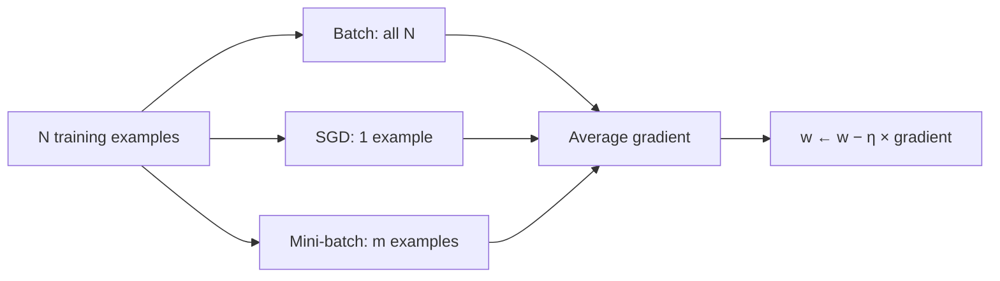

**In simple words:** every type of gradient descent moves the weights downhill on the loss. The types differ in how many training examples they look at before each step (batch, stochastic, mini-batch), and in how the step size is adjusted (momentum, Nesterov, AdaGrad, RMSProp, Adam).

**Definition:** gradient descent lowers the loss by moving each weight a little against its gradient (slope): $w \leftarrow w - \eta\,\nabla L$, where $\eta$ is the learning rate (step size) and $\nabla L$ is the gradient of the loss. <Cite id="gfdl-ch8" /> The gradient over the whole dataset is accurate but slow to compute; fewer examples are faster but noisier. That is why there are types.

**Worked example (one step, same for every type).**

<Sum>

<Given>

$w = 2$, $\eta = 0.1$, gradient $\nabla L = 4$.

</Given>

<Find>

the new weight.

</Find>

<Steps>

1. Step size $= \eta \times$ gradient $= 0.1 \times 4 = 0.4$.
2. Subtract it from the weight, which moves downhill: $2 - 0.4 = 1.6$.

</Steps>

<Answer>

new $w = 1.6$.

</Answer>

<Box kind="verify">

Take the loss $L = w^2$. Its gradient $2w$ is $4$ at $w = 2$, matching the given value. The loss falls from $L(2) = 4$ to $L(1.6) = 2.56$, and the gradient at $1.6$ is $3.2$, smaller, as expected when the weight nears the bottom.

</Box>

</Sum>

**1. Batch gradient descent.** Go through **all** $N$ examples, average their gradients, then make one update (1 update per epoch).
*Advantages:* exact gradient, smooth and stable path.
*Disadvantages:* slow and memory-heavy on large data; no progress until the full pass ends.

**2. Stochastic gradient descent.** Shuffle the data and update after **every single** example ($N$ updates per epoch).
*Advantages:* very cheap steps, learning starts at once, suits streaming data, and noise can help escape shallow bad spots.
*Disadvantages:* noisy, zig-zag path; weights wobble near the minimum unless the learning rate is lowered; poor GPU use.

**3. Mini-batch gradient descent.** Split the data into random groups of $m$ examples (often 32 to 256) and update after each group ($N/m$ updates per epoch).
*Advantages:* less noisy than SGD, much faster than batch, efficient on GPUs.
*Disadvantages:* batch size is one more setting to choose; some noise remains.

**Conclusion:** mini-batch gradient descent balances accuracy and speed, so almost all deep networks use it, usually with momentum or Adam. <Cite id="gfg-gd-variants" /> <Cite id="av-gd-variants" />
