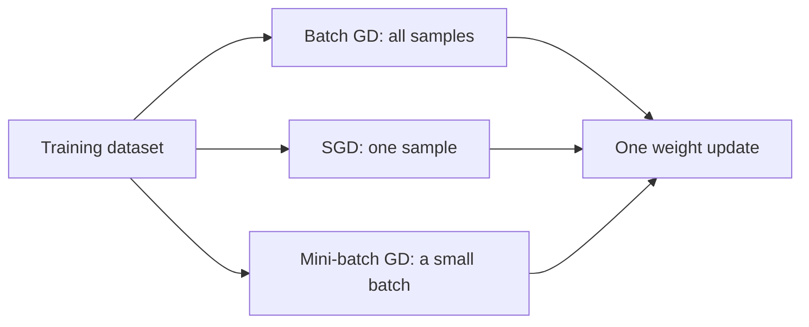

**In simple words:** the three types of gradient descent differ only in how much data is used before one weight update: all of it (batch), one sample (stochastic) or a small group (mini-batch). <Cite id="class-dl-m1" loc="p. 34" />

**Common idea:** gradient descent is an optimization algorithm that updates the weights and biases to reduce the loss: $W_{new} = W_{old} - \eta \dfrac{\partial L}{\partial W}$. <Cite id="class-dl-chp2" loc="slide 63" />

**1. Batch gradient descent.** It uses the entire training dataset to calculate the gradient before updating the weights (one update per epoch). It gives a smooth, stable path but is slow for large datasets and needs high memory. <Cite id="class-dl-chp2" loc="slide 68" />

**2. Stochastic gradient descent (SGD).** It updates the weights after processing only one training sample at a time: pick a sample, forward propagation, loss, backpropagation, update immediately, next sample. The formula uses the loss of one sample: $W_{new} = W_{old} - \eta\, \partial L_i / \partial W$. It is fast, needs little memory and suits very large datasets, but the path is noisy (zig-zag) and the loss fluctuates. <Cite id="class-dl-chp2" loc="slides 68 to 70" />

**3. Mini-batch gradient descent.** It divides the dataset into small groups called mini-batches (batch size 16, 32, 64 or 128) and updates the weights after each mini-batch: $W_{new} = W_{old} - \eta\, \partial L_{batch} / \partial W$. It is faster than batch GD, more stable than SGD, supports GPUs and is the most commonly used version. Example: 100 fruits with batch size 20 give 5 updates per epoch. <Cite id="class-dl-chp2" loc="slides 71 to 73" />

| | Batch GD | SGD | Mini-batch GD |
|---|---|---|---|
| Uses | Entire dataset | One sample | Small batch |
| Speed | Slow | Very fast | Fast |
| Learning path | Smooth | Zig-zag | Slight zig-zag |
| Stability | Stable | Noisy | Balanced |
| Memory | High | Low | Medium |

**Conclusion:** mini-batch gradient descent gives the best balance of speed and stability, so it is used most in deep learning.
