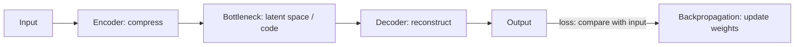

**In simple words:** autoencoder ke teen main parts hain: ek encoder jo input ko chhote code mein squeeze karta hai, khud code (bottleneck), aur ek decoder jo code se input wapas banata hai. <Cite id="class-dl-chp3" loc="slide 2" />

**Definition:** an autoencoder is an unsupervised neural network that learns to compress the input into a smaller representation (encoding) and then reconstruct the original input from that compressed representation. Goal: Input ≈ Output. <Cite id="class-dl-chp3" loc="slide 2" />

**Main components:** <Cite id="class-dl-chp3" loc="slides 2 and 3" />

- **Input:** raw data (image, audio, text), jaise 784 pixels ki 28 × 28 image.
- **Encoder:** high-dimensional input ko chhoti representation mein badalta hai aur important features nikalta hai (784 → 128 → 64 → 16).
- **Bottleneck (latent space / code):** sabse chhoti hidden layer; sirf sabse important information store karti hai.
- **Decoder:** code se original input reconstruct karta hai (16 → 64 → 128 → 784).
- **Output:** reconstructed data; input ke jitna ho sake close hona chahiye.

**Training:** output ko input se compare karo, loss calculate karo (MSE $= \dfrac{1}{n}\sum (x_i - \hat x_i)^2$ ya L1 $= \dfrac{1}{n}\sum |x_i - \hat x_i|$), backpropagate karke weights update karo; reconstruction error minimum hone tak repeat. <Cite id="class-dl-chp3" loc="slide 3" />

**Advantages:** bina labels seekhta hai, data compress karta hai, useful features seekhta hai, redundancy hataata hai. **Disadvantages:** output hamesha identical nahi, kuch information kho sakti hai, aur bottleneck size sahi chunna padta hai. <Cite id="class-dl-chp3" loc="slide 3" />

**Conclusion:** bottleneck network ko input ke sirf important features rakhne par majboor karta hai.

Exam mein English mein likho: "An autoencoder has an encoder, a bottleneck (code) and a decoder, and is trained so that the output is close to the input."
