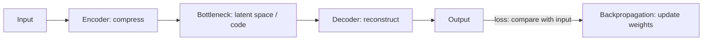

**In simple words:** an autoencoder has three main parts: an encoder that squeezes the input into a short code, the code (bottleneck) itself, and a decoder that rebuilds the input from the code. <Cite id="class-dl-chp3" loc="slide 2" />

**Definition:** an autoencoder is an unsupervised neural network that learns to compress the input into a smaller representation (encoding) and then reconstruct the original input from that compressed representation. Goal: Input ≈ Output. <Cite id="class-dl-chp3" loc="slide 2" />

**Main components:** <Cite id="class-dl-chp3" loc="slides 2 and 3" />

- **Input:** the raw data (image, audio, text), for example a 28 × 28 image of 784 pixels.
- **Encoder:** converts the high-dimensional input into a smaller representation and extracts important features (784 → 128 → 64 → 16).
- **Bottleneck (latent space / code):** the smallest hidden layer; it stores only the most important information.
- **Decoder:** uses the code to reconstruct the original input (16 → 64 → 128 → 784).
- **Output:** the reconstructed data; it should be as close as possible to the input.

**Training:** compare the output with the input, calculate the loss (MSE $= \dfrac{1}{n}\sum (x_i - \hat x_i)^2$ or L1 $= \dfrac{1}{n}\sum |x_i - \hat x_i|$), backpropagate and update the weights; repeat until the reconstruction error is minimum. <Cite id="class-dl-chp3" loc="slide 3" />

**Advantages:** learns without labels, compresses data, learns useful features, removes redundancy. **Disadvantages:** the output is not always identical, some information may be lost, and the bottleneck size must be chosen properly. <Cite id="class-dl-chp3" loc="slide 3" />

**Conclusion:** the bottleneck forces the network to keep only the important features of the input.
