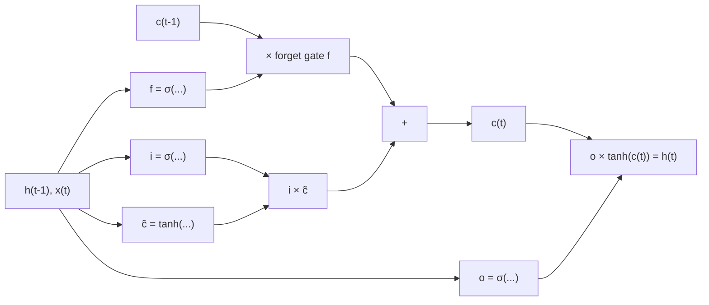

**In simple words:** LSTM (Long Short-Term Memory) ek RNN cell hai jiske paas alag long-term memory aur teen gates hote hain, jo decide karte hain ki kya bhoolna hai, kya add karna hai aur kya output dena hai, isliye wo door-door ke shabdon ko jod sakta hai.

**Plain RNN ki limitation.** Plain RNN har step pe apni poori memory dobara likh deta hai. Training mein time ke through peeche jaane wala error har step pe ek factor se multiply hota hai jo aksar 1 se kam hota hai, isliye wo **vanish** ho jaata hai aur RNN wo lambe sentence ke end ke "French" ko shuru ke "France" se nahi jod paata. <Cite id="gfdl-ch10" loc="§10.7" />

**LSTM ke parts aur working** <Cite id="nptel-dl" /> <Cite id="d2l-lstm" />

- **Cell state** $c_t$: long-term memory, time ke saath chalta "conveyor belt"; $h_t$ output hai.
- **Forget gate** $f_t$: purani memory kitni rakhni hai (0 sab hata deta hai, 1 sab rakhta hai).
- **Input gate** $i_t$: naya candidate memory $\tilde{c}_t$ kitna add karna hai.
- **Output gate** $o_t$: memory kitni bahar bhejni hai.

Har gate 0 se 1 ka number hai ($\odot$ matlab element-wise multiply):

$$
c_t = f_t \odot c_{t-1} + i_t \odot \tilde{c}_t, \qquad h_t = o_t \odot \tanh(c_t)
$$

**Limitation kaise dur hoti hai**

1. **Additive memory.** Memory scale aur add se update hoti hai, har step pe weight matrix se squash nahi hoti ("constant error carousel"). <Cite id="hochreiter1997" />
2. **Gradient highway.** Cell state ke raaste pe error sirf forget gate se multiply hota hai. Gate 1 ke paas rahe to error kai steps tak bachta hai, aur network seekhta hai ki ye kab karna hai.

**Worked example: 50 steps ke baad bacha error.** Maan lo error har step pe ek fixed factor se multiply hota hai.

<Sum>

<Given>

50 steps; plain RNN factor 0.5; LSTM forget gate 0.95.

</Given>

<Find>

har ek ke liye error ka kitna hissa bacha.

</Find>

<Steps>

1. RNN: $0.5^{50} = 1/2^{50}$, kyunki 0.5 se 50 baar multiply karna 50 baar aadha karne ke barabar hai. $2^{50} \approx 1.126 \times 10^{15}$ hai, to ye $\approx 8.9 \times 10^{-16}$ hai.
2. LSTM: $0.95^{50} = (0.95^{10})^5$ kyunki 50 matlab das ke paanch group. $0.95^{10} \approx 0.5987$, aur $0.5987^5 \approx 0.077$ (do baar square: $0.3585$, $0.1285$; phir $0.5987$ se multiply).

</Steps>

<Answer>

plain RNN error ka lagbhag $8.9 \times 10^{-16}$ rakhta hai (lagbhag kuch nahi); LSTM lagbhag 0.077 (abhi bhi kaam ka).

</Answer>

<Box kind="verify">

Logarithm se check karo.

$$
\begin{aligned}
50 \times \log_{10} 0.5 &= 50 \times (-0.301) \\
&= -15.05
\end{aligned}
$$

aur $10^{-15.05} \approx 8.9 \times 10^{-16}$. LSTM ke liye

$$
\begin{aligned}
50 \times \ln 0.95 &= 50 \times (-0.0513) \\
&= -2.565
\end{aligned}
$$

aur $e^{-2.565} \approx 0.077$. Dono match karte hain.

</Box>

</Sum>

**Advantages:** long-term memory, lambe sequences pe stable learning. **Disadvantages:** RNN se lagbhag chaar guna weights, isliye slow; exploding gradients ke liye ab bhi clipping chahiye. <Cite id="mlm-lstm" /> <Cite id="gfg-lstm" />

Exam mein English mein likho: "LSTM solves the vanishing gradient problem by using gates and an additive cell state."
