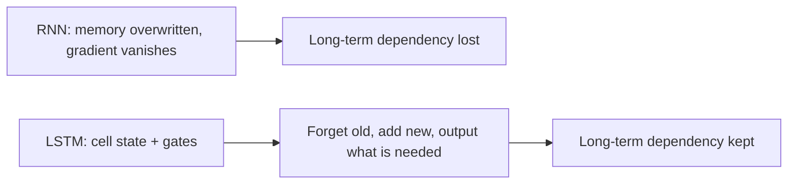

**In simple words:** plain RNN bahut pehle ki baatein bhool jaata hai, kyunki learning signal phika pad jaata hai. LSTM ek alag long-term memory aur gates jodta hai, isliye important information kai steps tak bachi rehti hai.

**RNN ki limitation:** BPTT mein gradient ko kai time steps peeche jaana padta hai, aur wo bahut chhota ho jaata hai (vanishing gradient). Pehle ke time steps ko lagbhag koi learning signal nahi milta, isliye RNN **long-term dependencies** nahi seekh paata ("I was born in India ... I speak Hindi"). <Cite id="class-dl-chp5" loc="slide 11" /> <Cite id="class-dl-m5" loc="p. 16" />

**LSTM:** ek special kind ka RNN jo long-term dependencies handle kar sakta hai. Isme hidden state (short-term memory) aur **cell state** (long-term memory) hota hai jo saare time steps mein information carry karta hai. <Cite id="class-dl-m5" loc="p. 21" />

**Ye limitation kaise door karta hai** <Cite id="class-dl-chp5" loc="slide 17" /> <Cite id="class-dl-chp5" loc="slide 18" />

1. **Forget gate** purani information hata deta hai jo ab useful nahi.
2. **Input gate** useful nayi information jodta hai. New cell state $C_t = f_t C_{t-1} + i_t N_t$.
3. **Output gate** chunta hai ki hidden state ke roop mein kya bahar jaaye, $H_t = o_t \tanh(C_t)$.
4. Cell state har step par thoda hi badalta hai, isliye useful information bachi rehti hai aur gradient ko time mein peeche jaane ka behtar raasta milta hai. LSTM bhi BPTT se train hota hai.

| Aspect | RNN | LSTM |
|---|---|---|
| Memory | Hidden state | Hidden state + cell state |
| Gates | Koi nahi | Forget, input, output |
| Long-term dependencies | Struggle | Handle karne ke liye designed |
| Vanishing gradient | Problem | Gates useful information bachate hain |

**Conclusion:** gated cell state LSTM ko wo yaad rakhne deta hai jo matter karta hai aur wo bhoolne deta hai jo nahi. <Cite id="class-dl-m5" loc="p. 18" />
