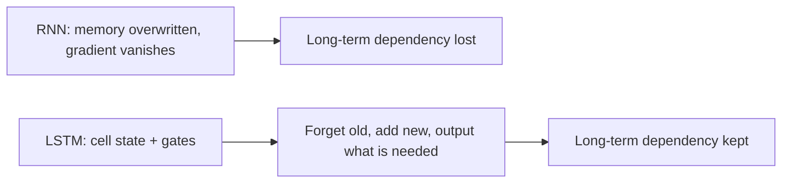

**In simple words:** a plain RNN forgets things that happened long ago, because the learning signal fades away. The LSTM adds a separate long-term memory and gates, so important information can stay for many steps.

**The limitation of the RNN:** during BPTT the gradient has to travel back through many time steps, and it becomes very small (vanishing gradient). Earlier time steps then get almost no learning signal, so the RNN cannot learn **long-term dependencies** ("I was born in India ... I speak Hindi"). <Cite id="class-dl-chp5" loc="slide 11" /> <Cite id="class-dl-m5" loc="p. 16" />

**LSTM:** a special kind of RNN capable of handling long-term dependencies. It has a hidden state (short-term memory) and a **cell state** (long-term memory) that carries information along all the time steps. <Cite id="class-dl-m5" loc="p. 21" />

**How it overcomes the limitation** <Cite id="class-dl-chp5" loc="slide 17" /> <Cite id="class-dl-chp5" loc="slide 18" />

1. **Forget gate** removes old information that is no longer useful.
2. **Input gate** adds useful new information. New cell state $C_t = f_t C_{t-1} + i_t N_t$.
3. **Output gate** selects what goes out as the hidden state, $H_t = o_t \tanh(C_t)$.
4. The cell state changes only a little at each step, so useful information survives and the gradient has a better path back through time. LSTM is still trained with BPTT.

| Aspect | RNN | LSTM |
|---|---|---|
| Memory | Hidden state | Hidden state + cell state |
| Gates | None | Forget, input, output |
| Long-term dependencies | Struggles | Designed to handle |
| Vanishing gradient | A problem | Gates preserve useful information |

**Conclusion:** the gated cell state lets the LSTM remember what matters and forget what does not. <Cite id="class-dl-m5" loc="p. 18" />
