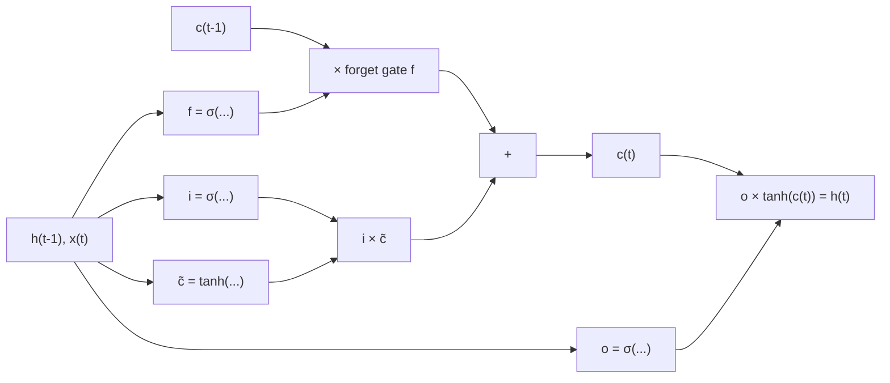

**In simple words:** an LSTM (Long Short-Term Memory) is an RNN cell with a separate long-term memory and three gates that decide what to forget, what to add and what to output, so it can link words that are far apart.

**The limitation of a plain RNN.** A plain RNN rewrites its whole memory at every step. During training, the error flowing back through time is multiplied at each step by a factor that is often below 1, so it **vanishes** and the RNN cannot link "French" at the end of a long sentence to "France" at the start. <Cite id="gfdl-ch10" loc="§10.7" />

**LSTM parts and working** <Cite id="nptel-dl" /> <Cite id="d2l-lstm" />

- **Cell state** $c_t$: the long-term memory, a "conveyor belt" through time; $h_t$ is the output.
- **Forget gate** $f_t$: how much old memory to keep (0 drops all, 1 keeps all).
- **Input gate** $i_t$: how much new candidate memory $\tilde{c}_t$ to add.
- **Output gate** $o_t$: how much memory to send out.

Each gate is a number from 0 to 1 ($\odot$ is element-wise multiply):

$$
c_t = f_t \odot c_{t-1} + i_t \odot \tilde{c}_t, \qquad h_t = o_t \odot \tanh(c_t)
$$

**How it overcomes the limitation**

1. **Additive memory.** The memory is updated by scaling and adding, not squashed through a weight matrix at every step (the "constant error carousel"). <Cite id="hochreiter1997" />
2. **Gradient highway.** Along the cell state, the error is multiplied only by the forget gate. If the gate stays near 1, the error survives many steps, and the network learns when to do so.

**Worked example: error left after 50 steps.** Assume the error is multiplied by a fixed factor at each step.

<Sum>

<Given>

50 steps; plain RNN factor 0.5; LSTM forget gate 0.95.

</Given>

<Find>

the fraction of error left, for each.

</Find>

<Steps>

1. RNN: $0.5^{50} = 1/2^{50}$, because 50 multiplications by 0.5 equal halving 50 times. As $2^{50} \approx 1.126 \times 10^{15}$, this is $\approx 8.9 \times 10^{-16}$.
2. LSTM: $0.95^{50} = (0.95^{10})^5$ because 50 is five groups of ten. $0.95^{10} \approx 0.5987$, and $0.5987^5 \approx 0.077$ (square twice: $0.3585$, $0.1285$; then multiply by $0.5987$).

</Steps>

<Answer>

the plain RNN keeps about $8.9 \times 10^{-16}$ of the error (practically nothing); the LSTM keeps about 0.077 (still usable).

</Answer>

<Box kind="verify">

Check with logarithms.

$$
\begin{aligned}
50 \times \log_{10} 0.5 &= 50 \times (-0.301) \\
&= -15.05
\end{aligned}
$$

and $10^{-15.05} \approx 8.9 \times 10^{-16}$. For the LSTM,

$$
\begin{aligned}
50 \times \ln 0.95 &= 50 \times (-0.0513) \\
&= -2.565
\end{aligned}
$$

and $e^{-2.565} \approx 0.077$. Both agree.

</Box>

</Sum>

**Advantages:** long-term memory, stable learning on long sequences. **Disadvantages:** about four times the weights of an RNN, so slower; exploding gradients still need clipping. <Cite id="mlm-lstm" /> <Cite id="gfg-lstm" />
