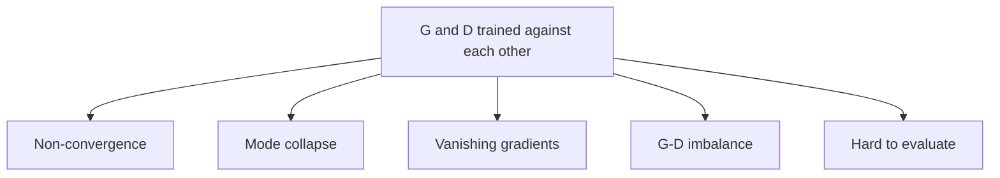

**In simple words:** vanilla GAN original 2014 wala GAN hai: ek generator jo random noise ko fake samples mein badalta hai, aur ek discriminator jo unhe pakadne ki koshish karta hai. Dono plain neural networks hain. Idea kaam karta hai, par do opponents ko saath seekhna mushkil hai, isliye training aksar fail hoti hai.

**Vanilla GAN kya hai.** Generator $G$ noise se fake banata hai. Discriminator $D$ batata hai ki sample real hone ki kitni chance hai. Dono turn-by-turn train hote hain: pehle $D$ fakes pakadna seekhta hai, phir $G$ $D$ ko dhokha dena seekhta hai. <Cite id="goodfellow2014" />

**Issues kyun aate hain.** Normal training ek loss ko kam karti hai aur neeche jaati hai. GAN mein ek network ki improvement doosre ka kaam mushkil karti hai, isliye follow karne ke liye koi ek "neeche ka raasta" nahi hota.

**1. Non-convergence.** Dono players ek doosre ka peecha karte reh sakte hain aur kabhi balance point pe nahi rukte, jaise do log rope ko baari-baari kheench rahe hon. Losses lagatar upar-neeche hote hain, aur kabhi samples achhe hone ke baad bigad jaate hain.

**2. Mode collapse.** Generator ek ya kuch outputs dhoondh leta hai jo $D$ ko dhokha de, aur sirf wahi banata rehta hai, isliye variety khatam ho jaati hai. Jaise, digits 0 se 9 pe train hua generator sirf ek digit bana sakta hai. <Cite id="gfg-gan-mode-collapse" />

**3. Vanishing gradients.** Agar $D$ jaldi bahut achha ho jaaye, to wo har fake ko poore confidence se reject karta hai. Tab original generator loss flat ho jaata hai, aur $G$ ko lagbhag koi learning signal nahi milta. Ye sabse bura tab hota hai jab real aur fake data mushkil se overlap karte hain.

**4. Imbalance between G and D.** Kamzor $D$ bekaar feedback deta hai; bahut strong $D$ vanishing gradients laata hai. Dono ko barabar rakhne ke liye learning rates aur network size par dhyan dena padta hai.

**5. Hard to evaluate.** Loss ki values ye nahi batati ki samples achhe hain ya nahi. Log samples dekhte hain ya Inception Score jaise alag scores use karte hain.

**6. Low quality aur no control.** Fully connected vanilla GANs chhoti, aksar noisy images dete hain, aur aap kisi khaas tarah ka output maang nahi sakte.

**Fixes (har ek ek line mein)** <Cite id="salimans2016" /> <Cite id="arjovsky2017-principled" />

| Issue | Fix |
|---|---|
| Vanishing gradients | Non-saturating loss (G koshish karta hai D "real" bole); Wasserstein loss |
| Mode collapse | Minibatch discrimination, unrolled GANs, WGAN |
| Non-convergence | Feature matching, one-sided label smoothing, D ke inputs pe noise |
| Low quality | DCGAN: convolutions, batch normalization, leaky ReLU |
| No control | Conditional GAN (G aur D dono ko label do) |

**Conclusion:** vanilla GAN adversarial idea achhe se dikhata hai, par unstable training, mode collapse aur vanishing gradients se pareshaan hai; DCGAN, conditional GAN aur WGAN inhe theek karne ke liye bane.

Exam mein English mein likho: "Vanilla GANs suffer from mode collapse, vanishing gradients and unstable training."
