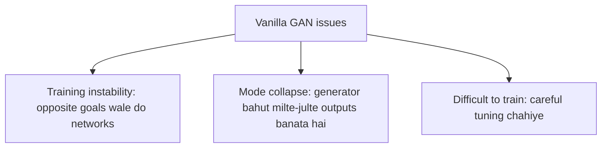

**In simple words:** vanilla GAN basic GAN hai jismein generator aur discriminator hote hain. Ye realistic data de sakta hai, lekin ise train karna aasan nahi: iske teen main issues hain, training instability, mode collapse aur training mein difficulty. <Cite id="class-dl-chp6" loc="slide 13" />

**1. Training instability.** GAN mein do networks ek saath opposite objectives ke saath seekhte hain: generator fake data banata hai aur discriminator ko fool karna chahta hai; discriminator real ya fake detect karta hai aur fool nahi hona chahta. Kabhi ek network dusre se bahut better ho jaata hai. Agar **discriminator bahut strong** ho, to generator bahut poor hota hai aur lagbhag har generated image fake pakdi jaati hai. Agar **generator bahut strong** ho, to wo tez improve hota hai aur discriminator struggle karta hai aur fake images sahi pehchaan nahi paata. Dono networks ko balanced tareeke se improve hona chahiye; warna training unstable ho jaati hai.

**2. Mode collapse.** Generator ko pata chal sakta hai ki sirf ek ya kuch hi types ke samples banana discriminator ko fool karne ke liye kaafi hai. Hum chahte hain kai alag faces (face 1 se face 5, appearance, features aur style mein variation ke saath); ho sakta hai baar-baar wahi face (face A) aaye. Mode collapse tab hota hai jab generator diverse samples ki jagah limited ya bahut milte-julte samples banata hai.

**3. Difficult to train.** GAN training mein kai factors ka careful selection chahiye: learning rate, network architecture, batch size, training strategy aur generator aur discriminator ke beech balance. Chhote changes training ko kaafi affect kar sakte hain, isliye GANs ko aksar kai trials aur adjustments chahiye; ye plug-and-play model nahi hai. <Cite id="class-dl-chp6" loc="slide 13" />

| Problem | Matlab |
|---|---|
| Training instability | Generator aur discriminator balanced tareeke se nahi seekh paate |
| Mode collapse | Generator limited ya milte-julte outputs banata hai |
| Training difficulty | GANs ko careful tuning aur experimentation chahiye |

**Conclusion:** GANs highly realistic data generate kar sakte hain, lekin unhe train karna challenging hai kyunki do networks ko balance banaye rakhte hue saath seekhna padta hai. <Cite id="class-dl-chp6" loc="slide 13" />
