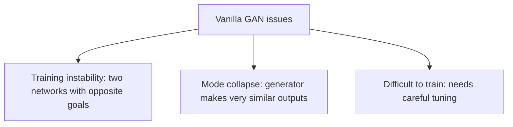

**In simple words:** a vanilla GAN is the basic GAN with a generator and a discriminator. It can give realistic data, but it is not easy to train: it has three main issues, training instability, mode collapse and difficulty in training. <Cite id="class-dl-chp6" loc="slide 13" />

**1. Training instability.** A GAN has two networks learning at the same time with opposite objectives: the generator creates fake data and tries to fool the discriminator; the discriminator detects real or fake and tries not to be fooled. Sometimes one network becomes much better than the other. If the **discriminator is too strong**, the generator is very poor and almost every generated image is identified as fake. If the **generator is too strong**, it improves fast and the discriminator struggles and cannot correctly identify fake images. Both networks need to improve in a balanced way; otherwise training becomes unstable.

**2. Mode collapse.** The generator may find that producing only one or a few types of samples is enough to fool the discriminator. What we want is many different faces (face 1 to face 5, with variation in appearance, features and style); what can happen is the same face (face A) again and again. Mode collapse occurs when the generator produces limited or very similar samples instead of diverse samples.

**3. Difficult to train.** GAN training needs careful selection of many factors: learning rate, network architecture, batch size, training strategy and the balance between generator and discriminator. Small changes can affect training significantly, so GANs often need many trials and adjustments; it is not a plug-and-play model. <Cite id="class-dl-chp6" loc="slide 13" />

| Problem | Meaning |
|---|---|
| Training instability | Generator and discriminator may not learn in a balanced way |
| Mode collapse | Generator produces limited or similar outputs |
| Training difficulty | GANs can require careful tuning and experimentation |

**Conclusion:** GANs can generate highly realistic data, but training them is challenging because the two networks must learn together while maintaining a balance. <Cite id="class-dl-chp6" loc="slide 13" />
