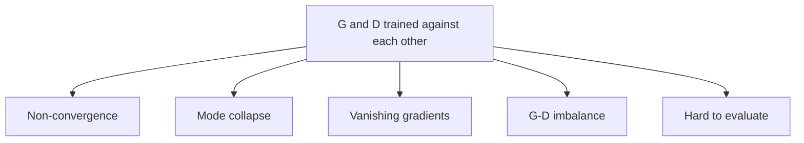

**In simple words:** a vanilla GAN is the original 2014 GAN: a generator that turns random noise into fake samples, and a discriminator that tries to catch them. Both are plain neural networks. The idea works, but making two opponents learn together is hard, so training often fails.

**What a vanilla GAN is.** The generator $G$ makes fakes from noise. The discriminator $D$ outputs the chance that a sample is real. They train in turns: $D$ learns to spot fakes, then $G$ learns to fool $D$. <Cite id="goodfellow2014" />

**Why the issues arise.** Normal training lowers one loss and moves downhill. In a GAN, each network's improvement makes the other's job harder, so there is no single downhill to follow.

**1. Non-convergence.** The two players may keep chasing each other and never settle at a balance point, like two people pulling a rope in turns. The losses keep swinging, and samples can get worse after getting better.

**2. Mode collapse.** The generator finds one or a few outputs that fool $D$ and keeps making only those, so variety is lost. For example, a generator trained on digits 0 to 9 may produce only one digit. <Cite id="gfg-gan-mode-collapse" />

**3. Vanishing gradients.** If $D$ becomes too good early, it rejects every fake with full confidence. The original generator loss then becomes flat, so $G$ gets almost no learning signal. This is worst when real and fake data hardly overlap.

**4. Imbalance between G and D.** A weak $D$ gives useless feedback; a strong $D$ causes vanishing gradients. Keeping them matched needs careful learning rates and network sizes.

**5. Hard to evaluate.** The loss values do not show whether samples are good. People must look at samples or use separate scores such as the Inception Score.

**6. Low quality and no control.** Fully connected vanilla GANs give small, often noisy images, and you cannot ask for a particular kind of output.

**Fixes (one line each)** <Cite id="salimans2016" /> <Cite id="arjovsky2017-principled" />

| Issue | Fix |
|---|---|
| Vanishing gradients | Non-saturating loss (G tries to make D say "real"); Wasserstein loss |
| Mode collapse | Minibatch discrimination, unrolled GANs, WGAN |
| Non-convergence | Feature matching, one-sided label smoothing, noise on D's inputs |
| Low quality | DCGAN: convolutions, batch normalization, leaky ReLU |
| No control | Conditional GAN (give a label to G and D) |

**Conclusion:** vanilla GANs show the adversarial idea well, but suffer from unstable training, mode collapse and vanishing gradients; DCGAN, conditional GAN and WGAN were designed to fix these.
