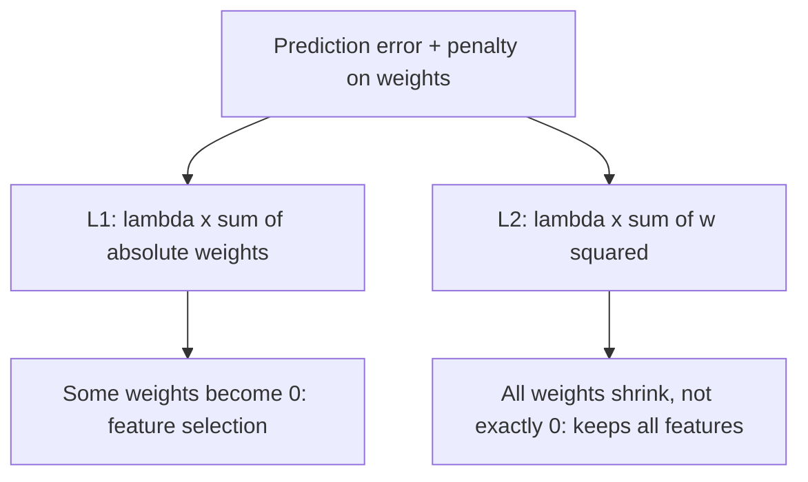

**In simple words:** L1 aur L2 dono loss mein weights ke size par penalty add karte hain, to network simple rehta hai; L1 weights ko zero tak dhakel sakta hai, L2 sirf chhota karta hai. <Cite id="class-dl-chp2" loc="slides 101 and 103" />

**Kyun zaroori:** overfitting kam karne ke liye regularization **Total Loss = Prediction Error + Regularization Penalty** banati hai, to bade weights discourage hote hain. $\lambda$ strength control karta hai. <Cite id="class-dl-chp2" loc="slide 97" />

**L1 regularization (Lasso).** Ye loss mein saare weights ki absolute values ka sum add karta hai: Total Loss = Prediction Loss + $\lambda \sum |w|$. Bade weights se badi penalty, to optimizer unhe kam karta hai aur kuch weights zero (ya zero ke kareeb) ho jaate hain: ye **feature selection** hai. Example: weights 6, −4, 2, −1 ki penalty $6 + 4 + 2 + 1 = 13$. **Advantages:** simpler, interpretable model. **Disadvantage:** $\lambda$ bada ho to useful features hata sakta hai. <Cite id="class-dl-chp2" loc="slides 101 and 102" /> Textbook kehta hai L1 sparse solutions deta hai aur feature selector ki tarah kaam karta hai. <Cite id="class-dl-m2" loc="p. 35" />

**L2 regularization (Ridge).** Ye saare weights ke squares ka sum add karta hai: Total Loss = Prediction Loss + $\lambda \sum w^2$. Ye saare weights shrink karta hai par usually zero nahi karta, to har feature use hota rehta hai. Example: weights 5, −3, 2, −1 se $25 + 9 + 4 + 1 = 39$. Ise weight decay bhi kehte hain aur deep learning mein sabse zyada use hota hai. <Cite id="class-dl-chp2" loc="slides 103 and 104" /> <Cite id="class-dl-m2" loc="p. 34" />

| | L1 (Lasso) | L2 (Ridge) |
|---|---|---|
| Penalty | $\lambda \sum \lvert w \rvert$ | $\lambda \sum w^2$ |
| Effect | Kuch weights 0 | Weights chhote, usually 0 nahi |
| Feature selection | Yes | No |

**Conclusion:** L1 unimportant features hataata hai, L2 saare weights shrink karta hai; Elastic Net dono use karta hai.

Exam mein English mein likho: "L1 adds lambda times the sum of absolute weights and L2 adds lambda times the sum of squared weights to the loss."
