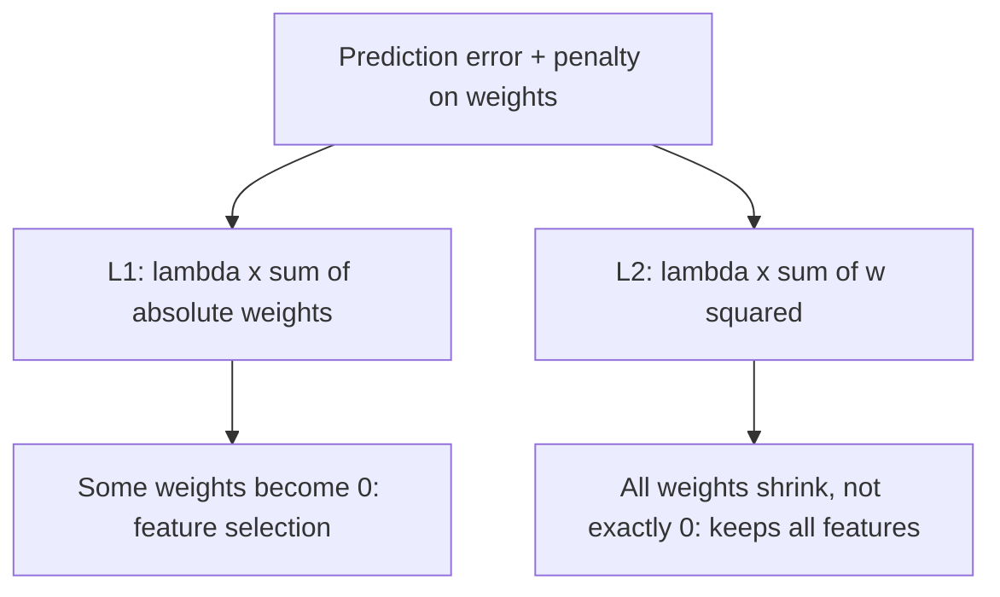

**In simple words:** both L1 and L2 add a penalty on the size of the weights to the loss, so the network stays simple; L1 can push weights to zero, L2 only makes them small. <Cite id="class-dl-chp2" loc="slides 101 and 103" />

**Why needed:** to reduce overfitting, regularization makes **Total Loss = Prediction Error + Regularization Penalty**, so large weights are discouraged. $\lambda$ controls the strength. <Cite id="class-dl-chp2" loc="slide 97" />

**L1 regularization (Lasso).** It adds the sum of the absolute values of all weights to the loss: Total Loss = Prediction Loss + $\lambda \sum |w|$. Large weights give a large penalty, so the optimizer reduces them and some weights become zero (or close to zero): this is **feature selection**. Example: weights 6, −4, 2, −1 give penalty $6 + 4 + 2 + 1 = 13$. **Advantages:** simpler, interpretable model. **Disadvantage:** may remove useful features if $\lambda$ is large. <Cite id="class-dl-chp2" loc="slides 101 and 102" /> The textbook says L1 gives sparse solutions and acts as a feature selector. <Cite id="class-dl-m2" loc="p. 35" />

**L2 regularization (Ridge).** It adds the sum of the squares of all weights: Total Loss = Prediction Loss + $\lambda \sum w^2$. It shrinks all weights but usually does not make them zero, so every feature is still used. Example: weights 5, −3, 2, −1 give $25 + 9 + 4 + 1 = 39$. It is also called weight decay and is the most used in deep learning. <Cite id="class-dl-chp2" loc="slides 103 and 104" /> <Cite id="class-dl-m2" loc="p. 34" />

| | L1 (Lasso) | L2 (Ridge) |
|---|---|---|
| Penalty | $\lambda \sum \lvert w \rvert$ | $\lambda \sum w^2$ |
| Effect | Some weights become 0 | Weights small, usually not 0 |
| Feature selection | Yes | No |

**Conclusion:** L1 removes unimportant features, L2 shrinks all weights; Elastic Net uses both.
