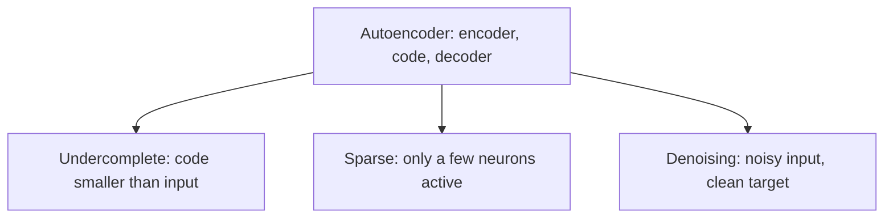

**In simple words:** saare autoencoders apna input compress karke rebuild karte hain; types is mein alag hain ki seekhne (copy nahi karne) ke liye wo kaunsa extra rule follow karte hain. Teen important types hain undercomplete, sparse aur denoising. <Cite id="class-dl-chp3" loc="slide 8" />

**1. Undercomplete autoencoder.** Hidden layer (bottleneck) mein input layer se kam neurons hote hain (Code Size < Input Size, jaise 784 → 64 → 784). Network data compress karne aur sirf important features rakhne par majboor hota hai. **Advantages:** meaningful features, simple copying rokta hai. **Disadvantage:** bahut chhota bottleneck information kho deta hai. <Cite id="class-dl-chp3" loc="slides 13 and 14" />

**2. Sparse autoencoder.** Ye ek samay mein sirf kuch hidden neurons ko active hone deta hai (jaise 100 mein se 5 se 10); baaki inactive. Sparsity penalty add hoti hai: **Total Loss = Reconstruction Loss + Sparsity Penalty** (activations par L1 ya KL divergence). Ye memorization rokta hai aur overcomplete hidden layer ke saath kaam karta hai. **Disadvantage:** bahut zyada sparsity important information kho sakti hai. <Cite id="class-dl-chp3" loc="slides 19 and 20" /> <Cite id="class-dl-m3" loc="p. 19" />

**3. Denoising autoencoder.** Ye noisy input leta hai par original clean input reconstruct karne ke liye train hota hai (Noisy Input → Autoencoder → Clean Output). Loss (MSE ya MAE) clean target ke against calculate hota hai, to Input (noisy) ≠ Target (clean). Noise types: Gaussian, salt-and-pepper, masking, speckle. Ye noise hataata hai aur robust features seekhta hai. <Cite id="class-dl-chp3" loc="slides 23 and 24" />

| | Undercomplete | Sparse | Denoising |
|---|---|---|---|
| Rule | Code input se chhota | Kam active neurons | Noisy input ke liye clean target |
| Loss | Reconstruction loss | Reconstruction + sparsity penalty | Clean input ke against reconstruction |

**Conclusion:** har type ek alag constraint add karta hai taaki autoencoder useful features seekhe aur input simply copy na kare.

Exam mein English mein likho: "Undercomplete has a smaller code, sparse has few active neurons, and denoising reconstructs a clean input from a noisy one."
