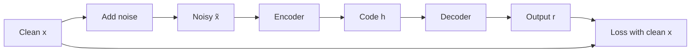

**In simple words:** har autoencoder mein ek encoder hota hai jo chhota code banata hai, aur ek decoder jo input ko wapas banata hai. Training aisi hoti hai ki output input ke kareeb aaye. Types is rule mein alag hote hain ki network seedha copy na kare. Teen types neeche samjhaye gaye hain.

**1. Undercomplete autoencoder**

- **Kya hai:** code input se chhota hota hai.
- **Kyun:** narrow bottleneck se har input ki perfect copy possible nahi hoti, to network sirf sabse important features rakhta hai, jaise film ko ek sentence mein batana.
- **Kaise:** output ko input se compare karke train karte hain. Koi extra penalty nahi chahiye. Ek simple linear decoder wahi seekh sakta hai jo PCA seekhta hai.
- **Pros / cons:** simple hai aur compression deta hai; bahut narrow ho to detail kho deta hai, bahut powerful ho to phir bhi ratta maar sakta hai.
- **Use:** compression aur dimensionality reduction.

**2. Denoising autoencoder**

- **Kya hai:** input ko kharab kiya jaata hai (kuch values zero karke, ya random noise jodkar), aur network ko **clean** input banana hota hai. <Cite id="vincent2008" />
- **Kyun:** noisy input ko copy karna saza hai, to network ko data ka asli structure seekhna padta hai, jaise kisi dhabbe wale page ko sahi likhna.
- **Kaise:** input ko corrupt karo, encode karo, decode karo, aur output ko clean input se compare karo. Har baar naya noise jodte hain.
- **Pros / cons:** robust features milte hain; noise ka type aur amount tune karna padta hai.
- **Use:** images aur audio se noise hatana.

**3. Sparse autoencoder**

- **Kya hai:** code bada ho sakta hai, par har input ke liye sirf kuch code neurons active hone chahiye.
- **Kyun:** har neuron ek hi pattern mein specialise karta hai, jaise hospital mein alag-alag specialists, jisse copy kiye bina rich aur samajh mein aane wale features milte hain.
- **Kaise:** code ke **activations** par penalty jodte hain: unpar L1 penalty, ya KL-divergence penalty jo har neuron ka average activity ek chhote target, jaise 0.05, ke paas rakhti hai. <Cite id="ufldl-autoencoders" />
- **Pros / cons:** rich aur interpretable features; tune karne ke liye extra settings.
- **Use:** classification ke liye features.

**Comparison** <Cite id="gfg-autoencoder-types" />

| Type | Rule against copying | Learns | Use |
|---|---|---|---|
| Undercomplete | Code input se chhota | Sabse important features | Compression |
| Denoising | Noisy input se clean input banana | Robust features | Denoising |
| Sparse | Kam active code neurons | Specialised features | Classification features |

**Conclusion:** teeno bina labels ke useful code seekhte hain; bas copy rokne ka tareeka badalta hai.

Exam mein English mein likho: "A denoising autoencoder is trained to reconstruct the clean input from a corrupted input."
