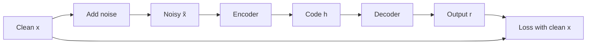

**In simple words:** every autoencoder has an encoder that makes a short code and a decoder that rebuilds the input, trained so the output is close to the input. The types differ in the rule that stops the network from simply copying the input. Three types are explained below.

**1. Undercomplete autoencoder**

- **What it is:** the code is smaller than the input.
- **Why:** the narrow bottleneck makes a perfect copy of every input impossible, so the network keeps only the most important features, like summing up a film in one sentence.
- **How:** train by comparing the output with the input. No extra penalty is needed. A simple linear decoder can learn what PCA learns.
- **Pros / cons:** simple, and gives compression; too narrow loses detail, too powerful can still memorize.
- **Use:** compression and dimensionality reduction.

**2. Denoising autoencoder**

- **What it is:** the input is corrupted (some values set to 0, or random noise added), and the network must output the **clean** input. <Cite id="vincent2008" />
- **Why:** copying the noisy input is punished, so it must learn the real structure of the data, like rewriting a smudged page correctly.
- **How:** corrupt the input, encode, decode, and compare the output with the clean input. New noise is added each time.
- **Pros / cons:** robust features; the type and amount of noise must be tuned.
- **Use:** removing noise from images and audio.

**3. Sparse autoencoder**

- **What it is:** the code may be large, but only a few code neurons may be active for each input.
- **Why:** each neuron specialises in one pattern, like specialists in a hospital, giving rich, readable features without copying.
- **How:** add a penalty on the code **activations**: an L1 penalty on them, or a KL-divergence penalty that keeps each neuron's average activity near a small target such as 0.05. <Cite id="ufldl-autoencoders" />
- **Pros / cons:** rich, interpretable features; extra settings to tune.
- **Use:** features for classification.

**Comparison** <Cite id="gfg-autoencoder-types" />

| Type | Rule against copying | Learns | Use |
|---|---|---|---|
| Undercomplete | Code smaller than input | Most important features | Compression |
| Denoising | Rebuild clean input from noisy input | Robust features | Denoising |
| Sparse | Few active code neurons | Specialised features | Classification features |

**Conclusion:** all three learn useful codes without labels; they only change how copying is prevented.
