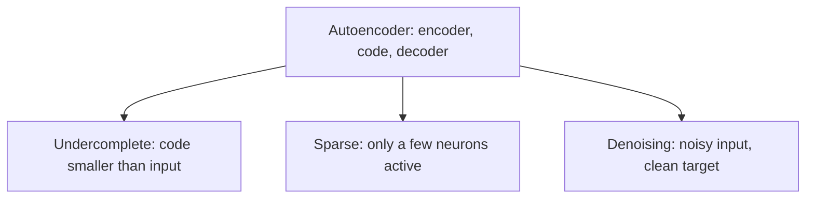

**In simple words:** all autoencoders compress and rebuild their input; the types differ in what extra rule they follow so that they learn instead of copy. Three important ones are undercomplete, sparse and denoising. <Cite id="class-dl-chp3" loc="slide 8" />

**1. Undercomplete autoencoder.** The hidden layer (bottleneck) has fewer neurons than the input layer (Code Size < Input Size, for example 784 → 64 → 784). The network is forced to compress the data and keep only the important features. **Advantages:** meaningful features, prevents simple copying. **Disadvantage:** a too-small bottleneck loses information. <Cite id="class-dl-chp3" loc="slides 13 and 14" />

**2. Sparse autoencoder.** It forces only a small number of hidden neurons to be active at a time (for example 5 to 10 of 100); most stay inactive. A sparsity penalty is added: **Total Loss = Reconstruction Loss + Sparsity Penalty** (L1 or KL divergence on the activations). It prevents memorization and works with an overcomplete hidden layer. **Disadvantage:** too much sparsity may lose important information. <Cite id="class-dl-chp3" loc="slides 19 and 20" /> <Cite id="class-dl-m3" loc="p. 19" />

**3. Denoising autoencoder.** It receives a noisy input but is trained to reconstruct the original clean input (Noisy Input → Autoencoder → Clean Output). The loss (MSE or MAE) is calculated against the clean target, so Input (noisy) ≠ Target (clean). Noise types: Gaussian, salt-and-pepper, masking, speckle. It removes noise and learns robust features. <Cite id="class-dl-chp3" loc="slides 23 and 24" />

| | Undercomplete | Sparse | Denoising |
|---|---|---|---|
| Rule | Code smaller than input | Few active neurons | Clean target for a noisy input |
| Loss | Reconstruction loss | Reconstruction + sparsity penalty | Reconstruction against clean input |

**Conclusion:** each type adds a different constraint so that the autoencoder learns useful features and does not simply copy the input.
