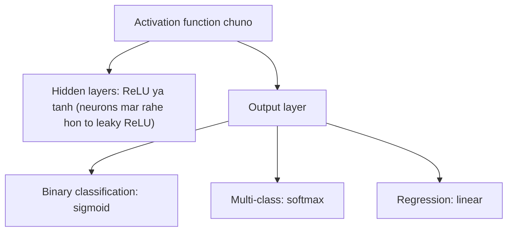

**In simple words:** activation function decide karta hai ki neuron activate ho ya nahi aur kitni strongly, aur ye network ko non-linear banata hai taaki wo complex patterns seekh sake. <Cite id="class-dl-m2" loc="p. 13" />

**Significance:**

1. **Non-linearity laata hai:** activation function ke bina network linear model ($y = z$) hai aur sirf linear relationships seekhta hai. <Cite id="class-dl-m2" loc="p. 13" />
2. **Neuron ka output control karta hai:** neuron ki firing aur output ki strength decide karta hai.
3. **Backpropagation mein help karta hai:** gradients network mein behte hain taaki learning ho sake; ReLU vanishing gradient problem se nikalne mein help karta hai.
4. **Output range decide karta hai** aur expressive power badhata hai; alag problems aur layers ke liye alag activation functions suitable hain. <Cite id="class-dl-chp2" loc="slide 25" />

**Activation functions ke types** <Cite id="class-dl-m2" loc="p. 13" />

| Function | Equation | Range | Use |
|---|---|---|---|
| Binary step | $z \ge 0$ to 1, warna 0 | $\{0, 1\}$ | Sabse purana; single-layer nets; differentiable nahi |
| Sigmoid | $1/(1 + e^{-z})$ | (0, 1) | Output layer, binary classification; vanishing gradient |
| Tanh | $(e^z - e^{-z})/(e^z + e^{-z})$ | (−1, 1) | Hidden layers; zero-centered |
| ReLU | $\max(0, z)$ | [0, ∞) | Hidden layers mein sabse zyada; dying ReLU |
| Leaky ReLU | $z > 0$ to $z$, warna $\alpha z$ | (−∞, ∞) | Dying ReLU fix ($\alpha$ lagbhag 0.01) |
| Softmax | $e^{z_i}/\sum_j e^{z_j}$ | (0, 1), sum 1 | Output layer, multi-class classification |
| Linear | $f(x) = x$ | (−∞, ∞) | Output layer, regression |

**Conclusion:** activation functions neural networks ka dil hain; choice problem type, layer aur speed aur stability jaise desired properties par depend karti hai. <Cite id="class-dl-m2" loc="p. 13" />
