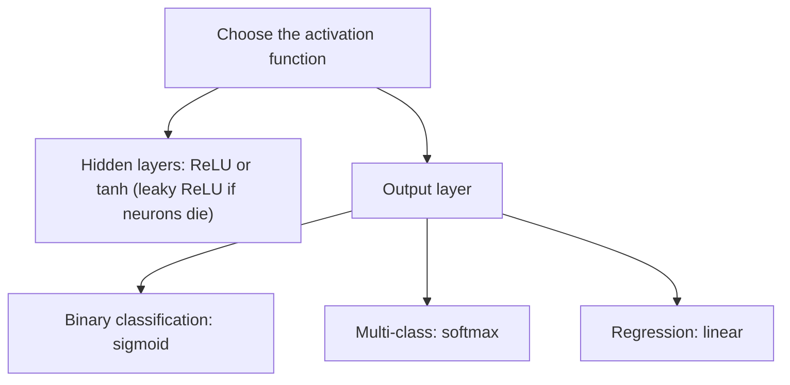

**In simple words:** an activation function decides whether a neuron should be activated and how strongly, and it makes the network non-linear so that it can learn complex patterns. <Cite id="class-dl-m2" loc="p. 13" />

**Significance:**

1. **Introduces non-linearity:** without an activation function the network is a linear model ($y = z$) and learns only linear relationships. <Cite id="class-dl-m2" loc="p. 13" />
2. **Controls the neuron output:** decides the firing of a neuron and the strength of its output.
3. **Helps backpropagation:** gradients flow through the network so learning can occur; ReLU helps overcome the vanishing gradient problem.
4. **Determines the output range** and adds expressive power; different activation functions suit different problems and layers. <Cite id="class-dl-chp2" loc="slide 25" />

**Types of activation functions** <Cite id="class-dl-m2" loc="p. 13" />

| Function | Equation | Range | Use |
|---|---|---|---|
| Binary step | 1 if $z \ge 0$, else 0 | $\{0, 1\}$ | Oldest; single-layer nets; not differentiable |
| Sigmoid | $1/(1 + e^{-z})$ | (0, 1) | Output layer, binary classification; vanishing gradient |
| Tanh | $(e^z - e^{-z})/(e^z + e^{-z})$ | (−1, 1) | Hidden layers; zero-centered |
| ReLU | $\max(0, z)$ | [0, ∞) | Most used in hidden layers; dying ReLU |
| Leaky ReLU | $z$ if $z > 0$, else $\alpha z$ | (−∞, ∞) | Fixes dying ReLU ($\alpha$ about 0.01) |
| Softmax | $e^{z_i}/\sum_j e^{z_j}$ | (0, 1), sum 1 | Output layer, multi-class classification |
| Linear | $f(x) = x$ | (−∞, ∞) | Output layer, regression |

**Conclusion:** activation functions are the heart of neural networks; the choice depends on the problem type, the layer and desired properties like speed and stability. <Cite id="class-dl-m2" loc="p. 13" />
