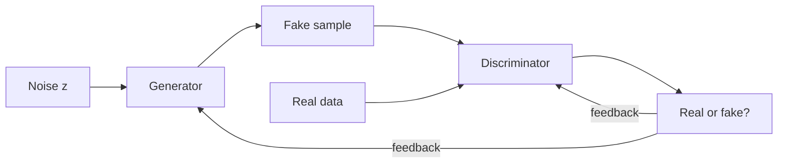

**In simple words:** Generative Adversarial Network (GAN) do neural networks ki jodi hai jo ek doosre se compete karke naya, real jaisa data (jaise chehre) banana seekhti hai. **Generator** random noise se fake banata hai; **discriminator** unhe pakadne ki koshish karta hai.

**Definition.** GAN (Goodfellow et al., 2014) ek generative model hai jisme generator aur discriminator ek doosre ke against train hote hain, jaise ek forger aur police. <Cite id="goodfellow2014" />

**Ye kyun zaroori hai.** Ye bina labels ke naya realistic data banata hai, aur har image ki probability compute kiye bina, jo kai purane generative models ko chahiye thi aur mushkil thi.

**Kaise kaam karta hai**

1. Generator random noise leta hai aur ek fake sample banata hai.
2. Discriminator ko ek real ya fake sample milta hai, aur wo batata hai ki ye real hone ki probability kitni hai.
3. Discriminator ko train kiya jaata hai ki real data ko "real" aur fakes ko "fake" bole.
4. Generator ko discriminator ke feedback se train kiya jaata hai, taaki wo aise fakes banaye jinhe discriminator "real" bole.
5. Dono turn-by-turn chalte hain. Ideally fakes itne achhe ho jaate hain ki discriminator har cheez ke liye $0.5$ deta hai. Tab discriminator hata diya jaata hai, aur generator naye noise se naye samples banata hai.

**Applications** <Cite id="mlm-gan-apps" />

| Application | Example |
|---|---|
| Image generation | Un logon ke realistic chehre jo exist hi nahi karte (StyleGAN) |
| Image-to-image translation | Sketch se photo, din se raat (pix2pix); horse se zebra (CycleGAN) |
| Super-resolution | Chhoti, dhundhli photo ko sharp karna (SRGAN) |
| Text-to-image | Ek sentence se picture banana |
| Inpainting aur editing | Missing hisse bharna, chehre ki umar badalna |
| Data augmentation | Real data kam ya private ho to synthetic medical images |
| Video aur 3D | Agle frames predict karna; 3D shapes banana |
| Deepfakes | Video mein kisi ka chehra ya awaaz badalna |

Original papers examples ke liye: <Cite id="karras2019" />, <Cite id="isola2017" />, <Cite id="zhu2017" />, <Cite id="ledig2017" />.

**Applications par comment**

- **Strengths:** GAN sharp aur realistic results dete hain aur labels nahi chahiye. Ye art, film, design, gaming aur medicine mein kaam aate hain, aur doosre models ke liye extra training data dete hain.
- **Risks:** deepfakes fake news phaila sakte hain, fraud kar sakte hain, ya real logon ko aise kaam karte dikha sakte hain jo unhone kiye hi nahi. Isliye deepfake detection aur misuse ke khilaaf laws ab zaroori hain. <Cite id="wiki-deepfake" />
- **Limits:** GAN train karna unstable hai aur variety kam ho sakti hai (mode collapse), to use se pehle outputs check karne chahiye.

**Conclusion:** GAN do competing networks se bane generative models hain; inhe images aur data banane aur edit karne mein wide use kiya jaata hai, aur inhe zimmedari se use karna chahiye.

Exam mein English mein likho: "A GAN has a generator and a discriminator that compete with each other."
