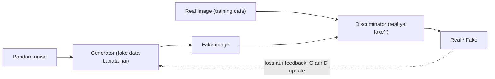

**In simple words:** GAN do neural networks se bana hai jo ek dusre ke against kaam karte hain: generator jo random noise se fake data banata hai aur discriminator jo check karta hai ki data real hai ya fake. Isse naya, realistic data generate kiya jaata hai. <Cite id="class-dl-chp6" loc="slide 3" />

**Definition:** Generative Adversarial Network (GAN) ek deep learning model hai jo real training data jaisa dikhne wala naya data generate karta hai. <Cite id="class-dl-chp6" loc="slide 3" />

**Components** <Cite id="class-dl-chp6" loc="slide 9" />

- **Random noise:** random numbers ka vector, jaise [0.2, −0.7, 1.1, ...]; sirf ek starting point. Alag noise se alag images aati hain. <Cite id="class-dl-chp6" loc="slide 8" />
- **Generator (G):** input random noise, output generated image; goal itna realistic dikhna ki discriminator fool ho jaaye (jaise artist realistic painting banata hai).
- **Discriminator (D):** input dataset ki real image ya generated image; output REAL ya FAKE; goal dono ko sahi alag pehchaanna (jaise art critic).

**Training loop:** generator fake image banata hai; discriminator real aur fake samples check karta hai; loss nikalta hai; backpropagation feedback deti hai; dono networks ke parameters update hote hain; process tab tak repeat hota hai jab tak generator realistic images na banaye. Training ke baad naye random noise ke saath sirf trained generator use hota hai. <Cite id="class-dl-chp6" loc="slide 10" /> <Cite id="class-dl-chp6" loc="slide 11" />

**Applications** <Cite id="class-dl-chp6" loc="slide 16" />

1. **Image generation:** naye human faces, objects, animals, scenery.
2. **DeepFake:** face swapping, face synthesis, facial expressions manipulate karna (misinformation aur fraud jaise serious misuse risks ke saath). <Cite id="class-dl-chp6" loc="slide 14" />
3. **Image-to-image translation:** sketch se realistic image, day se night, summer se winter.
4. **Image super-resolution:** low-resolution se high-resolution image.
5. **Image restoration:** noise hatana, damaged images theek karna, missing parts bharna (inpainting).
6. **Synthetic data ya data augmentation:** real data limited ho to zyada training samples.
7. **Video generation ya manipulation**, **8. art aur creative content**, **9. medical imaging** (research ke liye synthetic MRI-style images) aur **10. text-to-image generation.**

**Conclusion:** GAN real data se apne generator aur discriminator ke competition ke through seekhta hai, aur iski kai useful applications hain, ethical risks ke saath. <Cite id="class-dl-chp6" loc="slide 14" />
