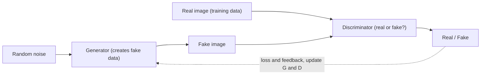

**In simple words:** a GAN is built from two neural networks that work against each other: a generator that creates fake data from random noise and a discriminator that checks whether data is real or fake. It is used to generate new, realistic data. <Cite id="class-dl-chp6" loc="slide 3" />

**Definition:** a Generative Adversarial Network (GAN) is a deep learning model used to generate new data that looks similar to real training data. <Cite id="class-dl-chp6" loc="slide 3" />

**Components** <Cite id="class-dl-chp6" loc="slide 9" />

- **Random noise:** a vector of random numbers, such as [0.2, −0.7, 1.1, ...]; only a starting point. Different noise gives different images. <Cite id="class-dl-chp6" loc="slide 8" />
- **Generator (G):** input random noise, output a generated image; goal is to look realistic enough to fool the discriminator (like an artist making a realistic painting).
- **Discriminator (D):** input a real image from the dataset or a generated image; output REAL or FAKE; goal is to distinguish them correctly (like an art critic).

**Training loop:** the generator creates a fake image; the discriminator checks real and fake samples; the loss is calculated; backpropagation gives feedback; the parameters of both networks are updated; the process repeats until the generator produces realistic images. After training, only the trained generator is used with new random noise. <Cite id="class-dl-chp6" loc="slide 10" /> <Cite id="class-dl-chp6" loc="slide 11" />

**Applications** <Cite id="class-dl-chp6" loc="slide 16" />

1. **Image generation:** new human faces, objects, animals, scenery.
2. **DeepFake:** face swapping, face synthesis, manipulating facial expressions (with serious misuse risks such as misinformation and fraud). <Cite id="class-dl-chp6" loc="slide 14" />
3. **Image-to-image translation:** sketch to realistic image, day to night, summer to winter.
4. **Image super-resolution:** low-resolution to high-resolution image.
5. **Image restoration:** remove noise, fix damaged images, fill missing parts (inpainting).
6. **Synthetic data or data augmentation:** more training samples when real data is limited.
7. **Video generation or manipulation**, **8. art and creative content**, **9. medical imaging** (synthetic MRI-style images for research) and **10. text-to-image generation.**

**Conclusion:** a GAN learns from real data through the competition between its generator and discriminator, and it has many useful applications along with ethical risks. <Cite id="class-dl-chp6" loc="slide 14" />
