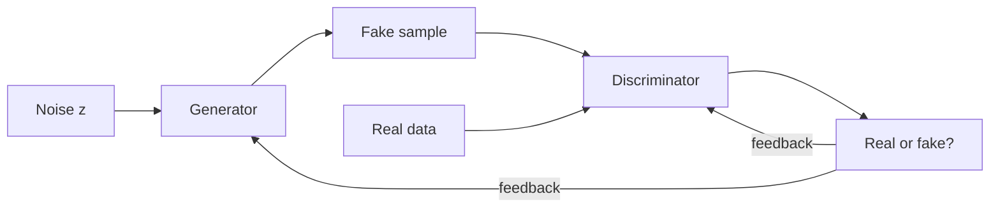

**In simple words:** a Generative Adversarial Network (GAN) is a pair of neural networks that learn to create new, realistic data (such as faces) by competing with each other. The **generator** makes fakes from random noise; the **discriminator** tries to catch them.

**Definition.** A GAN (Goodfellow et al., 2014) is a generative model in which a generator and a discriminator are trained against each other, like a forger and the police. <Cite id="goodfellow2014" />

**Why it is needed.** It creates new realistic data without labels, and without computing the probability of every image, which many older generative models needed and found hard.

**How it works**

1. The generator takes random noise and produces a fake sample.
2. The discriminator receives a real or a fake sample and outputs the probability that it is real.
3. The discriminator is trained to say "real" to real data and "fake" to fakes.
4. The generator is trained, using the discriminator's feedback, to make fakes that the discriminator calls "real".
5. They take turns. Ideally the fakes become so good that the discriminator outputs $0.5$ for everything. It is then discarded, and the generator makes new samples from new noise.

**Applications** <Cite id="mlm-gan-apps" />

| Application | Example |
|---|---|
| Image generation | Realistic faces of people who do not exist (StyleGAN) |
| Image-to-image translation | Sketch to photo, day to night (pix2pix); horse to zebra (CycleGAN) |
| Super-resolution | Sharpening a small, blurry photo (SRGAN) |
| Text-to-image | Drawing a picture from a sentence |
| Inpainting and editing | Filling in missing parts, face aging |
| Data augmentation | Synthetic medical images when real data is scarce or private |
| Video and 3D | Predicting next frames; generating 3D shapes |
| Deepfakes | Swapping a person's face or voice in a video |

Original papers for the examples: <Cite id="karras2019" />, <Cite id="isola2017" />, <Cite id="zhu2017" />, <Cite id="ledig2017" />.

**Comment on applications**

- **Strengths:** GANs give sharp, realistic results and need no labels. They help in art, film, design, gaming and medicine, and supply extra training data for other models.
- **Risks:** deepfakes can spread fake news, commit fraud or show real people doing things they never did, so deepfake detection and laws against misuse are now important. <Cite id="wiki-deepfake" />
- **Limits:** GANs are unstable to train and may produce limited variety (mode collapse), so outputs must be checked before use.

**Conclusion:** GANs are generative models built from two competing networks; they are widely used for creating and editing images and data, and must be used responsibly.
