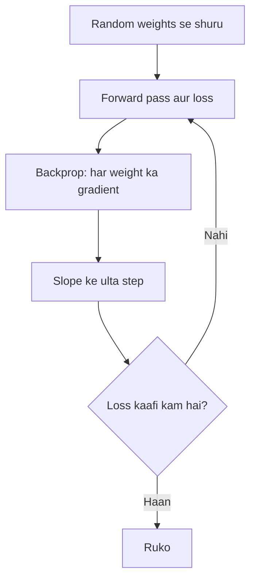

**In simple words:** gradient descent se network seekhta hai. Loss ek pahaad ki height hai, aur hum chhote steps lekar neeche utarte hain, us direction mein jahan loss sabse tezi se girta hai. <Cite id="d2l-gd" />

**Kaise kaam karta hai.** Lakhon weights haath se set nahi ho sakte, to har weight ka slope (gradient) naapte hain aur weight ko slope ke ulta move karte hain.

1. Random weights se shuru karo aur learning rate $\eta$ (step size) chuno.
2. Forward pass karo, phir loss nikaalo.
3. Backpropagation se har weight ka gradient $\partial L / \partial w$ milta hai. <Cite id="gfdl-ch8" />
4. Update: $w \leftarrow w - \eta \, \dfrac{\partial L}{\partial w}$ (naya weight = purana weight minus step size gunaa slope).
5. Bahut batches aur epochs tak repeat karo.

<Sum>

<Given>

$w = 2$, gradient $= 4$, $\eta = 0.1$, loss $L = w^2$.

</Given>

<Find>

ek step ke baad weight.

</Find>

<Steps>

1. **Step size:** $0.1 \times 4 = 0.4$.
2. **Slope ke ulta move karo** (slope uphill point karta hai, isliye subtract): $2 - 0.4 = 1.6$.

</Steps>

<Answer>

$w = 1.6$, aur loss 4 se girkar 2.56 ho jaata hai.

</Answer>

<Box kind="verify">

$w^2$ ka gradient $2w = 4$ hai $w = 2$ pe, jo diye hue value se match karta hai. Minimum $w = 0$ pe hai, to 2 se 1.6 pe aana sahi direction hai. Plug karke: $1.6^2 = 2.56 < 4$.

</Box>

</Sum>

**Limits:** learning rate ke prati sensitive; flat areas pe slow. Practice mein ye mini-batches pe chalta hai, aksar momentum ya Adam ke saath. <Cite id="gfg-gradient-descent" />

**Conclusion.** Chhote downhill steps baar-baar lene se weights kam loss tak pahunchte hain.

Exam mein English mein likho: "Gradient descent updates each weight by subtracting the learning rate times its gradient."
