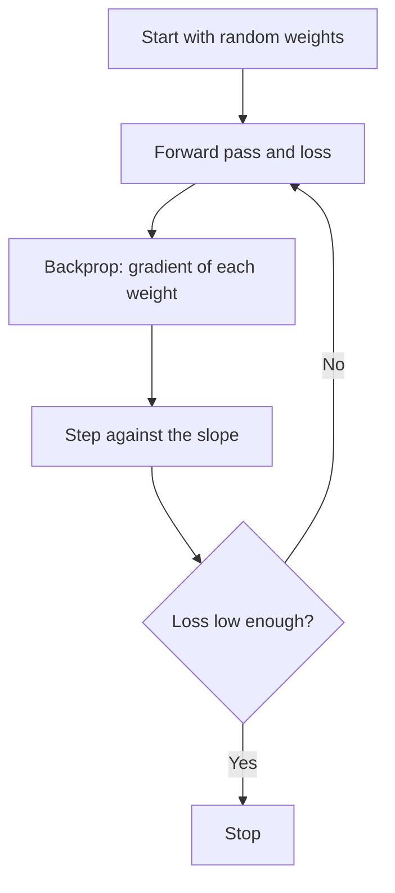

**In simple words:** gradient descent is how a network learns. The loss is the height of a hill, and we take small steps downhill, in the direction where the loss falls fastest. <Cite id="d2l-gd" />

**How it works.** We cannot set millions of weights by hand, so we measure each weight's slope (gradient) and move it against that slope.

1. Start with random weights and choose a learning rate $\eta$ (step size).
2. Forward pass, then compute the loss.
3. Backpropagation gives the gradient $\partial L / \partial w$ of every weight. <Cite id="gfdl-ch8" />
4. Update: $w \leftarrow w - \eta \, \dfrac{\partial L}{\partial w}$ (new weight = old weight minus step size times slope).
5. Repeat over many batches and epochs.

<Sum>

<Given>

$w = 2$, gradient $= 4$, $\eta = 0.1$, loss $L = w^2$.

</Given>

<Find>

the weight after one step.

</Find>

<Steps>

1. **Step size:** $0.1 \times 4 = 0.4$.
2. **Move against the slope** (the slope points uphill, so subtract): $2 - 0.4 = 1.6$.

</Steps>

<Answer>

$w = 1.6$, and the loss falls from 4 to 2.56.

</Answer>

<Box kind="verify">

The gradient of $w^2$ is $2w = 4$ at $w = 2$, matching the given value. The minimum is at $w = 0$, so moving from 2 to 1.6 is the right way. Plugging in: $1.6^2 = 2.56 < 4$.

</Box>

</Sum>

**Limits:** sensitive to the learning rate; slow on flat areas. In practice it runs on mini-batches, often with momentum or Adam. <Cite id="gfg-gradient-descent" />

**Conclusion.** Repeated small downhill steps bring the weights to a low loss.
