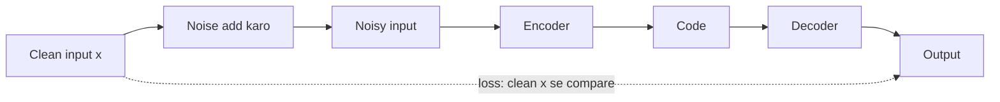

**In simple words:** denoising autoencoder ek autoencoder hai jo data saaf karna seekhta hai. Hum usko noisy input dete hain aur training karte hain ki wo clean output de. <Cite id="vincent2008" />

**Ye kyun zaroori hai.** Normal autoencoder input ko bas copy kar sakta hai. Noise add karne se copy karna kaam nahi aata, to network ko data ka asli structure seekhna padta hai.

**Kaise kaam karta hai**

1. Clean input ko corrupt karo: kuch values ko 0 karo (masking) ya random Gaussian noise add karo.
2. Encoder noisy input ko ek code mein compress karta hai.
3. Decoder code se output banata hai.
4. Loss output ko clean input se compare karta hai, noisy se nahi. Backpropagation weights update karta hai, aur har step mein naya noise use hota hai.

**Fayde:** robust features seekhta hai, aur noise ki wajah se code input se bada bhi ho sakta hai, bina copy kiye. **Nuksaan:** sirf wahi noise hata sakta hai jo training mein dekha ho, aur output dhundhla (blurry) ho sakta hai.

**Applications:** noisy images aur audio saaf karna, purane scanned documents restore karna, aur gehre networks ko pre-train karna. <Cite id="gfg-denoising-autoencoder" /> <Cite id="keras-denoising-autoencoder" /> <Cite id="gfdl-ch14" />

**Conclusion.** Noise hatana seekhne se DAE ko pata chal jaata hai ki asli data kaisa dikhta hai.

Exam mein English mein likho: "A denoising autoencoder is trained to reconstruct the clean input from a corrupted version."
