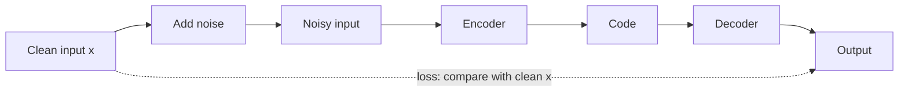

**In simple words:** a denoising autoencoder is an autoencoder that learns to clean up data. We give it a noisy input and train it to output the clean version. <Cite id="vincent2008" />

**Why it is needed.** A normal autoencoder can simply copy its input. Adding noise makes copying useless, so the network must learn the real structure of the data.

**How it works**

1. Corrupt the clean input: set some values to 0 (masking) or add random Gaussian noise.
2. The encoder compresses the noisy input into a code.
3. The decoder rebuilds an output from the code.
4. The loss compares the output with the clean input, not the noisy one. Backpropagation updates the weights, and fresh noise is used at each step.

**Advantages:** learns robust features, and the noise lets the code be larger than the input without the network just copying. **Disadvantages:** it removes only the kinds of noise it was trained on, and outputs can look blurry.

**Applications:** cleaning noisy images and audio, restoring old scanned documents, and pre-training deeper networks. <Cite id="gfg-denoising-autoencoder" /> <Cite id="keras-denoising-autoencoder" /> <Cite id="gfdl-ch14" />

**Conclusion.** Learning to remove noise forces the autoencoder to learn what real data looks like.
