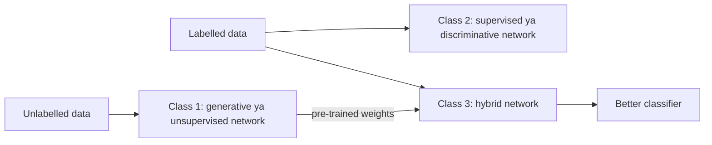

**In simple words:** deep learning networks apne kaam ke hisaab se teen classes mein aate hain. **Generative ya unsupervised** networks bina labels ke seekhte hain ki data kaisa dikhta hai. **Supervised ya discriminative** networks seekhte hain ki sahi label kaun sa hai. **Hybrid** networks pehle bina labels ke seekhte hain, aur phir us gyaan se classification better karte hain.

**Ye grouping kyun?** Ye do practical sawaal ka jawab deti hai: kya labels available hain, aur kya hum data ko samajhna ya banana chahte hain, ya sirf classify karna chahte hain.

**Class 1: unsupervised ya generative deep networks**

- **Definition:** jab koi class label available na ho, tab observed data ke high-order patterns pakadte hain, analysis ya synthesis ke liye. Generative mode mein ye seekhte hain ki data kaise spread hai, isliye ye naye samples bana sakte hain.
- **Working:** network apne input ko dobara banana ya copy karna seekhta hai; uski hidden layers data ka seekha hua summary ban jaati hain.
- **Examples:** deep autoencoder (code mein compress karke input dobara banana), RBM, deep belief network, deep Boltzmann machine; baad mein GANs.
- **Advantages / limits:** bina labelled data ke use karta hai aur generate kar sakta hai; lekin exact training aksar intractable hoti hai aur pure classification mein ye kamzor hai.
- **Uses:** feature learning, compression, noise hatana, images ya speech generate karna.

**Class 2: supervised ya discriminative deep networks**

- **Definition:** classification ke liye discriminative power dete hain, aksar har class ki probability input diye hue ke hisaab se model karke. Labels hamesha available hote hain.
- **Working:** predict karo, label se error napo, aur backpropagation se weights sudhaaro.
- **Examples:** deep MLP (DNN), images ke liye CNN, sequence (speech ya handwriting) ko label karne wala RNN, deep stacking network.
- **Advantages / limits:** fast, accurate aur end-to-end; lekin bahut saare labelled examples chahiye.
- **Uses:** spam filtering, face aur speech recognition.

**Class 3: hybrid deep networks**

- **Definition:** aim discrimination hi hai, lekin generative ya unsupervised network ke results se help milti hai (aksar kaafi zyada). Ismein generative network ko discriminative goal ke saath train karna bhi shaamil hai.
- **Working (DBN-DNN):** (1) unlabelled data pe DBN ko layer by layer train karo; (2) uske weights se utne hi shape wala DNN initialise karo; (3) labels ke saath backpropagation se fine-tune karo. CNNs ko autoencoders se pre-train karna bhi isi tarah ka hai.
- **Why it works:** **optimization** ke liye better starting point, aur **regularization** (ek prior) ki tarah kaam karta hai, isliye ye better train hota hai aur kam overfit karta hai, khaas karke kam labels mein.
- **Advantages / limits:** kam labels mein achha; lekin do stages mein zyada time lagta hai.
- **Uses:** speech recognition (DBN-DNN acoustic models), kam labelled scans wali medical imaging.

| | Generative | Discriminative | Hybrid |
|---|---|---|---|
| Labels | Zaroori nahi | Zaroori | Thode labels plus unlabelled data |
| Learns | Data kaisa dikhta hai | Input ke diye hue class | Dono, stages mein |
| Example | Autoencoder, DBN | CNN, DNN | DBN-DNN |

**Conclusion.** Teen classes hain: generative, discriminative aur hybrid; hybrid class isliye useful hai kyunki generative pre-training se deep discriminative networks kaafi help hote paaye gaye.

Exam mein English mein likho: "The three classes of deep learning are generative (unsupervised), discriminative (supervised) and hybrid."
