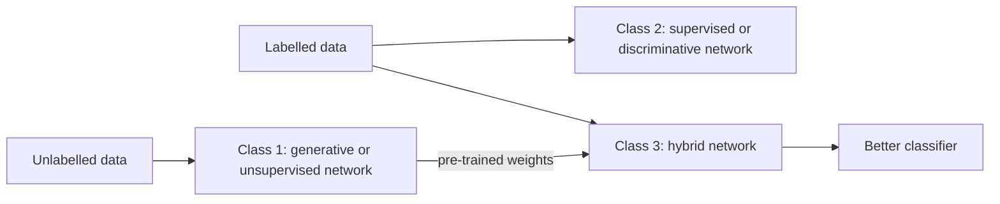

**In simple words:** deep learning networks fall into three classes according to their purpose. **Generative or unsupervised** networks learn what the data looks like without labels. **Supervised or discriminative** networks learn to give the correct label. **Hybrid** networks first learn without labels and then use that knowledge to classify better.

**Why this grouping?** It answers two practical questions: are labels available, and do we want to understand or create data, or only classify it?

**Class 1: unsupervised or generative deep networks**

- **Definition:** capture high-order patterns in the observed data for analysis or synthesis when no class labels are available. In generative mode they learn how the data is spread out, so they can create new samples.
- **Working:** the network learns to rebuild or imitate its input; its hidden layers become a learned summary of the data.
- **Examples:** deep autoencoder (compress to a code, rebuild the input), RBM, deep belief network, deep Boltzmann machine; later GANs.
- **Advantages / limits:** uses unlabelled data and can generate; but exact training is often intractable and it is weaker at pure classification.
- **Uses:** feature learning, compression, noise removal, generating images or speech.

**Class 2: supervised or discriminative deep networks**

- **Definition:** provide discriminative power for classification, often by modelling the probability of each class given the input. Labels are always available.
- **Working:** predict, measure the error against the label, and correct the weights by backpropagation.
- **Examples:** deep MLP (DNN), CNN for images, RNN that labels a sequence (speech or handwriting), deep stacking network.
- **Advantages / limits:** fast, accurate and end-to-end; but needs many labelled examples.
- **Uses:** spam filtering, face and speech recognition.

**Class 3: hybrid deep networks**

- **Definition:** the aim is discrimination, assisted (often significantly) by the results of a generative or unsupervised network. It can also mean training a generative network with a discriminative goal.
- **Working (DBN-DNN):** (1) train a DBN layer by layer on unlabelled data; (2) use its weights to initialise a DNN of the same shape; (3) fine-tune with labels by backpropagation. Pre-training CNNs with autoencoders is similar.
- **Why it works:** a better starting point for **optimization**, and **regularization** (a prior), so it trains better and overfits less, especially with few labels.
- **Advantages / limits:** good with scarce labels; but two stages cost more time.
- **Uses:** speech recognition (DBN-DNN acoustic models), medical imaging with few labelled scans.

| | Generative | Discriminative | Hybrid |
|---|---|---|---|
| Labels | Not needed | Needed | Few plus unlabelled data |
| Learns | What the data looks like | Class given the input | Both, in stages |
| Example | Autoencoder, DBN | CNN, DNN | DBN-DNN |

**Conclusion.** The three classes are generative, discriminative and hybrid; the hybrid class is useful because generative pre-training was found to greatly help deep discriminative networks.
