**In simple words:** AlexNet (Krizhevsky, Sutskever aur Hinton, 2012) ek bada CNN hai jo ImageNet contest (ILSVRC-2012) jeet gaya, top-5 error 15.3% ke saath, jabki second-best entry ka 26.2% tha. Ye LeNet ka idea hai jise bada aur deep banaya gaya, GPUs pe train kiya gaya, aur ReLU aur dropout ke saath.

**Definition:** AlexNet ek 8-layer CNN hai (5 convolutional + 3 fully connected), lagbhag 60 million parameters aur 1000-way softmax output ke saath.

**Why it was needed:** ImageNet mein 1000 classes ki 10 lakh se zyada badi colour photos hain, jo LeNet jaise chhote networks ke liye bahut zyada hain. Ek bahut bada network chahiye tha, aur use dheemi training aur bhari overfitting ko handle karna tha.

**How it works**

1. Input: 227×227×3 colour image.
2. Conv1: 96 filters, har ek 11×11, stride 4 → 55×55×96, phir max pool.
3. Conv2: 256 filters 5×5 ke → 27×27×256, phir max pool.
4. Conv3, Conv4: 384 filters 3×3 ke; Conv5: 256 filters 3×3 ke, phir max pool → 6×6×256.
5. FC6 aur FC7: har ek mein 4096 units, dropout ke saath; FC8: 1000-way softmax.

```mermaid
%% caption: AlexNet. Max pooling conv1, conv2 aur conv5 ke baad hai. Dropout pehli do fully connected layers mein use hota hai.
flowchart LR
  A["Input 227×227×3"] --> B["Conv1 96 of 11×11, stride 4: 55×55×96, pool to 27×27"]
  B --> C["Conv2 256 of 5×5: 27×27×256, pool to 13×13"]
  C --> D["Conv3 384 of 3×3: 13×13"]
  D --> E["Conv4 384 of 3×3: 13×13"]
  E --> F["Conv5 256 of 3×3, pool to 6×6×256"]
  F --> G["FC6 4096 + dropout"]
  G --> H["FC7 4096 + dropout"]
  H --> I["FC8 1000 softmax"]
```

(Paper mein 224×224 likha hai, lekin sizes sirf 227 ya extra padding ke saath sahi aate hain.)

**Analysis of the design choices**

1. **ReLU** tanh ki jagah: positive inputs ke liye saturate nahi hota, isliye gradients bade rehte hain; paper ke CIFAR-10 test mein ReLU network 25% training error tak tanh network se lagbhag chhe guna tez pahuncha.
2. **Do GPUs:** har ek mein sirf 3 GB tha, isliye layers ko split kiya gaya; training mein paanch se chhe din lage.
3. **Local response normalization** conv1 aur conv2 ke baad (baad mein batch normalization se replace hua).
4. **Overlapping max pooling** (3×3, stride 2) ne error thoda kam kiya.
5. **Dropout** (0.5) FC6 aur FC7 mein, bhari overfitting ke khilaaf.
6. **Data augmentation:** random crops, flips aur colour changes.

**Where the parameters are:** conv layers mein sirf lagbhag 3.7 million hain; FC layers mein lagbhag 58.6 million. Yani FC layers sabse mehngi hain aur sabse zyada overfit karti hain, isliye dropout wahin lagaya gaya ek wajah se.

**Advantages:** accuracy mein bada jump; ReLU, dropout, augmentation aur GPU training ko standard bana diya.

**Limitations:** bahut zyada memory use, zyadatar FC layers mein; bade 11×11 filters (baad mein VGG mein 3×3 ke stacks se replace hue); sirf 8 layers.

**Applications:** bade paimane par image classification aur detection aur medical images ke liye transfer learning.

**Conclusion:** AlexNet ne dikhaya ki GPUs pe train hua deep CNN haath se banaye features ko bahut bade margin se haraata hai, aur isne modern deep learning era shuru kiya.

Exam mein English mein likho: "AlexNet has 8 layers (5 convolutional and 3 fully connected) and uses ReLU, dropout and GPU training."
