**In simple words:** AlexNet wo CNN hai jisne 2012 ka ImageNet competition jeeta. Isne dikhaya ki bahut saare data par GPUs se train hua deep CNN image features khud seekh sakta hai.

```mermaid
%% caption: AlexNet: paanch convolution layers (1, 2 aur 5 ke baad max pooling) aur teen fully connected layers.
flowchart LR
  A["Input 227×227×3"] --> B["Conv1 96 filters 11×11, s4 → 55×55×96"]
  B --> C["Pool → 27×27×96"]
  C --> D["Conv2 256, 5×5 → 27×27×256"]
  D --> E["Pool → 13×13×256"]
  E --> F["Conv3, Conv4 384, Conv5 256 → 13×13×256"]
  F --> G["Pool → 6×6×256"]
  G --> H["FC6 4096, FC7 4096 (dropout 0.5)"]
  H --> I["FC8 1000 + softmax"]
```

**Definition:** AlexNet ek deep CNN architecture hai jo 2012 mein ImageNet image-classification mein outstanding performance se landmark bana aur computer vision ke liye deep learning ko popular kiya. Ise Krizhevsky, Sutskever aur Hinton ne banaya. <Cite id="class-dl-chp4" loc="slide 46" />

**Architecture ka analysis** <Cite id="class-dl-m4" loc="p. 57" /> <Cite id="class-dl-m4" loc="p. 58" /> <Cite id="class-dl-m4" loc="p. 60" />

- **8 learnable layers:** 5 convolutional aur 3 fully connected. Output (softmax) ko chhod kar har layer ke baad ReLU.
- Output size $= \lfloor (N + 2P - F)/S \rfloor + 1$, jaise $(227 - 11)/4 + 1 = 55$.
- Filters ki sankhya depth ke saath **badhti** hai (96, 256, 384, 384, 256) aur filter size **ghatta** hai (11, 5, 3, 3, 3), isliye deeper layers complex features seekhti hain. Pooling size aadha karta hai, depth nahi.
- Lagbhag **62 million parameters**, zyadatar fully connected layers mein.

**Key features** <Cite id="class-dl-m4" loc="p. 55" />

| Feature | Effect |
|---|---|
| tanh ki jagah ReLU | Training lagbhag 6 guna tez |
| GPU training | Bada model, tez training |
| Overlapping max pooling | Error 0.5% kam |
| Dropout (0.5) aur data augmentation | 60 million parameters ka overfitting kam |

**Demerits:** pehli layers mein dormant neurons aur bade pehle-layer filter se aliasing. <Cite id="class-dl-m4" loc="p. 85" />

**Conclusion:** AlexNet ne saabit kiya ki deep CNNs, big data aur GPUs state-of-the-art image classification dete hain. <Cite id="class-dl-chp4" loc="slide 46" />
