**In simple words:** AlexNet is the CNN that won the 2012 ImageNet competition. It showed that a deep CNN trained with GPUs on a lot of data can learn image features by itself.

```mermaid
%% caption: AlexNet: five convolution layers (with max pooling after 1, 2 and 5) and three fully connected layers.
flowchart LR
  A["Input 227×227×3"] --> B["Conv1 96 filters 11×11, s4 → 55×55×96"]
  B --> C["Pool → 27×27×96"]
  C --> D["Conv2 256, 5×5 → 27×27×256"]
  D --> E["Pool → 13×13×256"]
  E --> F["Conv3, Conv4 384, Conv5 256 → 13×13×256"]
  F --> G["Pool → 6×6×256"]
  G --> H["FC6 4096, FC7 4096 (dropout 0.5)"]
  H --> I["FC8 1000 + softmax"]
```

**Definition:** AlexNet is a deep CNN architecture that became a landmark in 2012 by achieving outstanding ImageNet image-classification performance and popularizing deep learning for computer vision. It was developed by Krizhevsky, Sutskever and Hinton. <Cite id="class-dl-chp4" loc="slide 46" />

**Analysis of the architecture** <Cite id="class-dl-m4" loc="p. 57" /> <Cite id="class-dl-m4" loc="p. 58" /> <Cite id="class-dl-m4" loc="p. 60" />

- **8 learnable layers:** 5 convolutional and 3 fully connected. ReLU follows every layer except the output (softmax).
- Output size $= \lfloor (N + 2P - F)/S \rfloor + 1$, for example $(227 - 11)/4 + 1 = 55$.
- The number of filters **increases** with depth (96, 256, 384, 384, 256) and the filter size **decreases** (11, 5, 3, 3, 3), so deeper layers learn more complex features. Pooling halves the size, never the depth.
- About **62 million parameters**, most of them in the fully connected layers.

**Key features** <Cite id="class-dl-m4" loc="p. 55" />

| Feature | Effect |
|---|---|
| ReLU instead of tanh | Training about 6 times faster |
| GPU training | Bigger model, faster training |
| Overlapping max pooling | Error reduced by 0.5% |
| Dropout (0.5) and data augmentation | Reduce overfitting of the 60 million parameters |

**Demerits:** dormant neurons in the first layers and aliasing from the large first-layer filter. <Cite id="class-dl-m4" loc="p. 85" />

**Conclusion:** AlexNet proved that deep CNNs, big data and GPUs give state-of-the-art image classification. <Cite id="class-dl-chp4" loc="slide 46" />
