**In simple words:** AlexNet (Krizhevsky, Sutskever and Hinton, 2012) is a large CNN that won the ImageNet contest (ILSVRC-2012) with a top-5 error of 15.3%, against 26.2% for the second-best entry. It is LeNet's idea made much bigger and deeper, trained on GPUs with ReLU and dropout.

**Definition:** AlexNet is an 8-layer CNN (5 convolutional + 3 fully connected) with about 60 million parameters and a 1000-way softmax output.

**Why it was needed:** ImageNet has over a million large colour photos in 1000 classes, far beyond small networks like LeNet. A much bigger network was needed, and it had to overcome slow training and heavy overfitting.

**How it works**

1. Input: 227×227×3 colour image.
2. Conv1: 96 filters of 11×11, stride 4 → 55×55×96, then max pool.
3. Conv2: 256 filters of 5×5 → 27×27×256, then max pool.
4. Conv3, Conv4: 384 filters of 3×3; Conv5: 256 filters of 3×3, then max pool → 6×6×256.
5. FC6 and FC7: 4096 units each with dropout; FC8: 1000-way softmax.

```mermaid
%% caption: AlexNet. Max pooling follows conv1, conv2 and conv5. Dropout is used in the first two fully connected layers.
flowchart LR
  A["Input 227×227×3"] --> B["Conv1 96 of 11×11, stride 4: 55×55×96, pool to 27×27"]
  B --> C["Conv2 256 of 5×5: 27×27×256, pool to 13×13"]
  C --> D["Conv3 384 of 3×3: 13×13"]
  D --> E["Conv4 384 of 3×3: 13×13"]
  E --> F["Conv5 256 of 3×3, pool to 6×6×256"]
  F --> G["FC6 4096 + dropout"]
  G --> H["FC7 4096 + dropout"]
  H --> I["FC8 1000 softmax"]
```

(The paper says 224×224, but the sizes only work out with 227 or extra padding.)

**Analysis of the design choices**

1. **ReLU** instead of tanh: does not saturate for positive inputs, so gradients stay large; in the paper's CIFAR-10 test a ReLU network reached 25% training error about six times faster than a tanh one.
2. **Two GPUs:** each had only 3 GB, so the layers were split; training took five to six days.
3. **Local response normalization** after conv1 and conv2 (later replaced by batch normalization).
4. **Overlapping max pooling** (3×3, stride 2) slightly lowered the error.
5. **Dropout** (0.5) in FC6 and FC7 against heavy overfitting.
6. **Data augmentation:** random crops, flips and colour changes.

**Where the parameters are:** the conv layers hold only about 3.7 million; the FC layers about 58.6 million. So the FC layers are the most expensive and most prone to overfitting, which is one reason dropout was placed there.

**Advantages:** huge accuracy jump; made ReLU, dropout, augmentation and GPU training standard.

**Limitations:** very large memory use, mostly in FC layers; big 11×11 filters (later replaced by stacks of 3×3 in VGG); still only 8 layers.

**Applications:** large-scale image classification and transfer learning for detection and medical images.

**Conclusion:** AlexNet showed that a deep CNN trained on GPUs beats hand-designed features by a wide margin, and it started the modern deep learning era.
