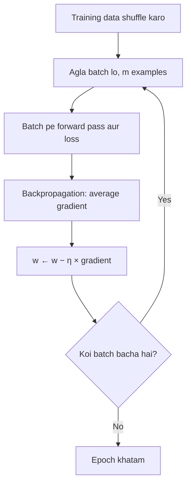

**In simple words:** gradient descent loss ko kam karta hai, har weight ko uske gradient ki ulti disha mein move karke. Iske types is baat mein alag hain ki har step mein kitna data use hota hai aur har step ka size kaise tay hota hai.

**Definition:** gradient descent ek iterative optimization method hai: naya weight = purana weight − learning rate × gradient, $w \leftarrow w - \eta\,\nabla L$.

**Why different types are needed:** bade datasets pe poore data ka step dheema hota hai, ek-ek example pe step shor (noisy) hota hai, aur ek fixed step size kuch weights ke liye sahi hota hai, kuch ke liye nahi.

**Types of gradient descent**

- Data ki matra ke hisaab se: batch, stochastic (SGD), mini-batch.
- Step kaise adjust hota hai uske hisaab se: momentum, Nesterov accelerated gradient, AdaGrad, RMSProp, Adam.

Neeche teen ko explain kiya gaya hai.

**1. Batch gradient descent.** Gradient poore **training set** pe nikaala jaata hai, phir ek update kiya jaata hai.
- Steps: sab data pe forward pass → average gradient → ek update → agla epoch.
- *Pros:* exact gradient, smooth convergence. *Cons:* har epoch mein ek hi update, bade data pe dheema aur memory bhari.

**2. Stochastic gradient descent (SGD).** Har **ek** random example ke baad weights update hote hain.
- *Pros:* fast, sasta, har epoch mein $N$ updates, online kaam karta hai, noise shallow minima se nikalne mein help karta hai.
- *Cons:* noisy path, loss upar-neeche jaata hai aur weights minimum ke paas hilte rehte hain.

**3. Mini-batch gradient descent.** Har chhote random **batch** ke $m$ examples ke baad weights update hote hain.
- *Pros:* gradient ka achha estimate, sasta step, GPUs pe fast; deep learning ka default (libraries ise "SGD" kehti hain).
- *Cons:* batch size tune karna padta hai aur memory mein fit hona chahiye.

<Sum>

<Given>

$w = 0.5$, $\eta = 0.1$, gradient $= 2$; $N = 6000$ images ka dataset, batch size $m = 100$.

</Given>

<Find>

naya weight, aur ek epoch mein har method ke updates.

</Find>

<Steps>

1. **Weight update:** $0.5 - 0.1 \times 2 = 0.3$ (gradient ke ulta move, isliye weight neeche jaata hai).
2. **Updates per epoch:** batch GD 1 karta hai, SGD 6000, mini-batch $6000 / 100 = 60$.

</Steps>

<Answer>

$w = 0.3$; har epoch mein 1, 6000 aur 60 updates.

</Answer>

<Box kind="verify">

Step ko ulta karo: $0.3 + 0.1 \times 2 = 0.5$, yaani shuru ka weight. Mini-batch: $60 \times 100 = 6000$, to ek epoch mein har image ek baar use hoti hai.

</Box>

</Sum>

| | Batch | SGD | Mini-batch |
|---|---|---|---|
| Data per update | Sab $N$ | 1 example | $m$ examples |
| Updates per epoch | 1 | $N$ | $N/m$ |
| Path | Smooth | Bahut noisy | Zyadatar smooth |
| Memory | Poora dataset | Bahut kam | Ek batch |
| Best for | Chhote datasets | Online ya streaming data | Deep learning |

**Applications:** image CNNs aur language models ki mini-batch training; online recommendation systems mein SGD; chhoti regression problems mein batch GD.

**Conclusion:** batch accurate hai lekin dheema, SGD fast hai lekin noisy, aur mini-batch dono ka achha hissa leta hai. Practice mein ise momentum ya Adam ke saath mila kar faster aur steady training hoti hai.

Exam mein English mein likho: "Mini-batch gradient descent updates the weights after each small batch of training examples."
