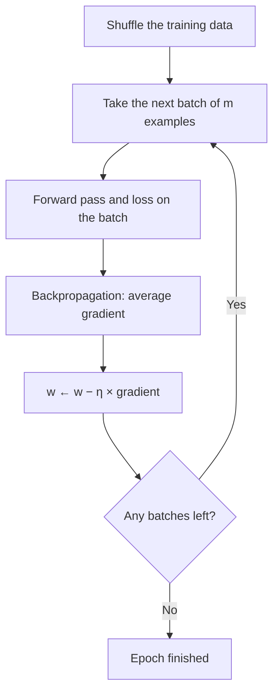

**In simple words:** gradient descent lowers the loss by moving each weight against its gradient. Its types differ in how much data each step uses and in how each step is sized.

**Definition:** gradient descent is an iterative optimization method: new weight = old weight − learning rate × gradient, $w \leftarrow w - \eta\,\nabla L$.

**Why different types are needed:** large datasets make full-data steps slow, single examples make steps noisy, and one fixed step size suits some weights but not others.

**Types of gradient descent**

- By amount of data: batch, stochastic (SGD), mini-batch.
- By how the step is adjusted: momentum, Nesterov accelerated gradient, AdaGrad, RMSProp, Adam.

Three are explained below.

**1. Batch gradient descent.** The gradient is computed on the **whole** training set, then one update is made.
- Steps: forward pass on all data → average gradient → one update → next epoch.
- *Pros:* exact gradient, smooth convergence. *Cons:* one update per epoch, slow and memory-hungry on large data.

**2. Stochastic gradient descent (SGD).** The weights are updated after **every single** random example.
- *Pros:* fast, cheap, $N$ updates per epoch, works online, noise can escape shallow minima.
- *Cons:* noisy path, the loss jumps around and the weights keep wobbling near the minimum.

**3. Mini-batch gradient descent.** The weights are updated after each small random **batch** of $m$ examples.
- *Pros:* good gradient estimate, cheap steps, fast on GPUs; the default in deep learning (libraries call it "SGD").
- *Cons:* batch size must be tuned and must fit in memory.

<Sum>

<Given>

$w = 0.5$, $\eta = 0.1$, gradient $= 2$; a dataset of $N = 6000$ images with batch size $m = 100$.

</Given>

<Find>

the new weight, and the updates in one epoch for each method.

</Find>

<Steps>

1. **Weight update:** $0.5 - 0.1 \times 2 = 0.3$ (move against the gradient, so the weight goes down).
2. **Updates per epoch:** batch GD makes 1, SGD makes 6000, mini-batch makes $6000 / 100 = 60$.

</Steps>

<Answer>

$w = 0.3$; 1, 6000 and 60 updates per epoch.

</Answer>

<Box kind="verify">

Undo the step: $0.3 + 0.1 \times 2 = 0.5$, the starting weight. Mini-batch: $60 \times 100 = 6000$, so one epoch uses every image once.

</Box>

</Sum>

| | Batch | SGD | Mini-batch |
|---|---|---|---|
| Data per update | All $N$ | 1 example | $m$ examples |
| Updates per epoch | 1 | $N$ | $N/m$ |
| Path | Smooth | Very noisy | Mostly smooth |
| Memory | Whole dataset | Very little | One batch |
| Best for | Small datasets | Online or streaming data | Deep learning |

**Applications:** mini-batch training of image CNNs and language models; SGD in online recommendation systems; batch GD in small regression problems.

**Conclusion:** batch is accurate but slow, SGD is fast but noisy, and mini-batch takes the best of both. In practice it is combined with momentum or Adam for faster, steadier training.
