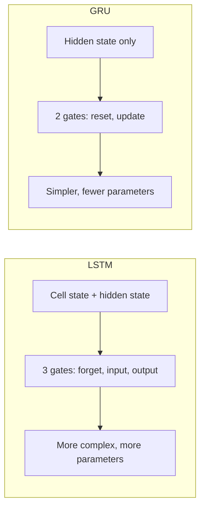

**In simple words:** LSTM aur GRU dono gates wale RNN cells hain jo long-term information yaad rakhne mein madad karte hain. LSTM mein teen gates aur do memories hain; GRU simpler hai, do gates aur ek memory.

**LSTM architecture:** hidden state (short-term memory) aur cell state (long-term memory), aur **3 gates**: forget gate (bekaar purani information hatao), input gate (useful nayi information jodo) aur output gate (output mein kya dikhana hai chuno). $C_t = f_t C_{t-1} + i_t N_t$, $H_t = o_t \tanh(C_t)$. <Cite id="class-dl-m5" loc="p. 20" /> <Cite id="class-dl-m5" loc="p. 24" />

**GRU architecture:** **alag cell state nahi**; hidden state hi memory hai. **2 gates**: reset gate (past ka kitna use karna) aur update gate (kitni purani aur nayi information rakhni). $h_t = z_t h_{t-1} + (1 - z_t)\tilde{h}_t$. <Cite id="class-dl-chp5" loc="slide 20" /> <Cite id="class-dl-m5" loc="p. 28" />

| Feature | LSTM | GRU |
|---|---|---|
| Main memory | Cell state + hidden state | Hidden state |
| Gates | 3 main gates | 2 main gates |
| Forget / input / output gate | Haan | Nahi |
| Reset / update gate | Nahi | Haan |
| Structure | Zyada complex | Simpler |
| Parameters | Zyada | Kam |
| Power | Zyada powerful (3 gates) | Simpler, isliye bade models ban sakte hain |

<Cite id="class-dl-chp5" loc="slide 21" /> <Cite id="class-dl-m5" loc="p. 31" />

**Conclusion:** dono basic RNN ki long-term dependencies handle karne ki ability badhate hain, lekin information control karne ke tareeke alag hain. Power ke liye LSTM, simplicity ke liye GRU.
