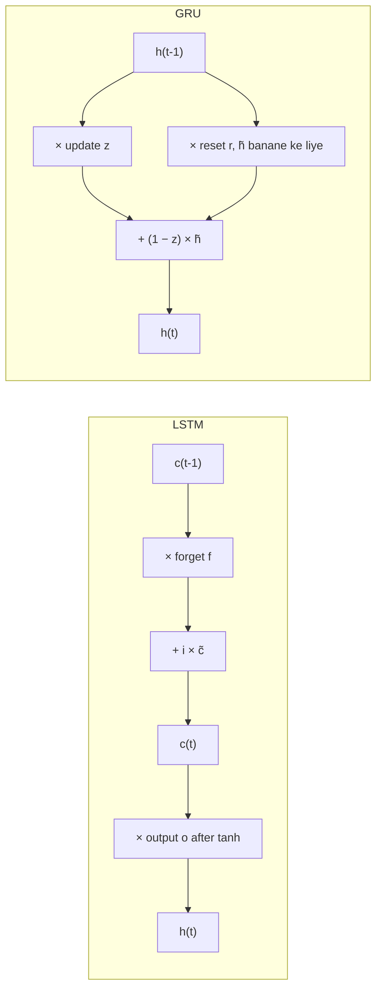

**In simple words:** LSTM aur GRU dono RNN cells hain jo gates (0 aur 1 ke beech ke numbers) se memory control karte hain, taaki lambe time tak information yaad rahe. LSTM mein ek alag memory line aur teen gates hote hain. GRU ek simple design hai jismein ek memory aur do gates hote hain.

**Why both exist.** Ek plain RNN lambe pehle ke inputs bhool jaata hai kyunki gradients vanish ho jaate hain. Dono cells gates ke zariye purani memory ko rakhkar ye problem theek karte hain, use dobara likhne ke bajaye. LSTM pehle aaya (1997); GRU (2014) ek halka version bana kar design kiya gaya. <Cite id="hochreiter1997" /> <Cite id="cho2014" />

**LSTM architecture**

1. Do state lines: **cell state** $c_t$ (lambi memory) aur **hidden state** $h_t$ (output).
2. **Forget gate:** purani memory mein se kitna rakhna hai.
3. **Input gate** tanh **candidate** ke saath: naye information mein se kitna add karna hai.
4. **Output gate:** kitni memory $h_t$ ke roop mein dikhani hai.

$$
c_t = f_t \odot c_{t-1} + i_t \odot \tilde{c}_t, \qquad h_t = o_t \odot \tanh(c_t)
$$

**GRU architecture** <Cite id="d2l-gru" />

1. Ek state line: sirf **hidden state** $h_t$.
2. **Reset gate** $r_t$: candidate $\tilde{h}_t$ banate waqt purani memory mein se kitna use karna hai.
3. **Update gate** $z_t$: purane state ka $z_t$ hissa rakho aur candidate ka $1 - z_t$ hissa lo.

$$
h_t = z_t \odot h_{t-1} + (1 - z_t) \odot \tilde{h}_t
$$

Har gate, pichhle hidden state aur current input ka sigmoid hai; $\odot$ element-wise product hai. <Cite id="gfdl-ch10" loc="§10.10" />

**Differences**

| Point | LSTM | GRU |
|---|---|---|
| Gates | 3: forget, input, output | 2: update, reset |
| Memory | Alag cell state aur hidden state | Sirf hidden state |
| Keep vs add | Alag forget aur input gates | Ek update gate: $z$ rakho, $1 - z$ add karo |
| Output gate | Haan, dikhai jaane wali memory control karta hai | Nahi, poora state output hota hai |
| Weight sets | 4 | 3, lagbhag 25% kam parameters |
| Speed | Dheema | Fast, kam memory |
| Proposed | 1997 (forget gate 2000) | 2014 |
| Best suited to | Bahut lambe sequences, bada data | Kam data, limited compute |

**Similarity.** Dono purani memory ko naye state mein blend karte hain, use dobara likhne ke bajaye, isliye gradients kai steps tak peeche jaate hain. Studies mein dono ki accuracy lagbhag same mili, koi hamesha better nahi. <Cite id="chung2014" /> <Cite id="gfg-rnn-lstm-gru" />

**Conclusion:** GRU ek halka LSTM hai: kam gates, cell state nahi, fast training; LSTM memory par zyada fine control deta hai.

Exam mein English mein likho: "The GRU has two gates (update and reset) and no separate cell state, while the LSTM has three gates and a cell state."
