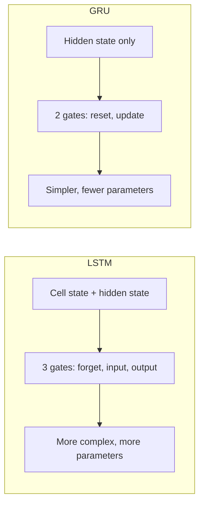

**In simple words:** both LSTM and GRU are RNN cells with gates that help remember long-term information. The LSTM has three gates and two memories; the GRU is simpler, with two gates and one memory.

**LSTM architecture:** a hidden state (short-term memory) and a cell state (long-term memory), and **3 gates**: forget gate (remove useless old information), input gate (add useful new information) and output gate (select what to output). $C_t = f_t C_{t-1} + i_t N_t$, $H_t = o_t \tanh(C_t)$. <Cite id="class-dl-m5" loc="p. 20" /> <Cite id="class-dl-m5" loc="p. 24" />

**GRU architecture:** **no separate cell state**; the hidden state is the memory. **2 gates**: the reset gate (how much of the past to use) and the update gate (how much old and new information to keep). $h_t = z_t h_{t-1} + (1 - z_t)\tilde{h}_t$. <Cite id="class-dl-chp5" loc="slide 20" /> <Cite id="class-dl-m5" loc="p. 28" />

| Feature | LSTM | GRU |
|---|---|---|
| Main memory | Cell state + hidden state | Hidden state |
| Gates | 3 main gates | 2 main gates |
| Forget / input / output gate | Yes | No |
| Reset / update gate | No | Yes |
| Structure | More complex | Simpler |
| Parameters | More | Fewer |
| Power | More powerful (3 gates) | Simpler, so bigger models can be built |

<Cite id="class-dl-chp5" loc="slide 21" /> <Cite id="class-dl-m5" loc="p. 31" />

**Conclusion:** both improve the basic RNN's handling of long-term dependencies but use different ways to control information. Choose LSTM for power and GRU for simplicity.
