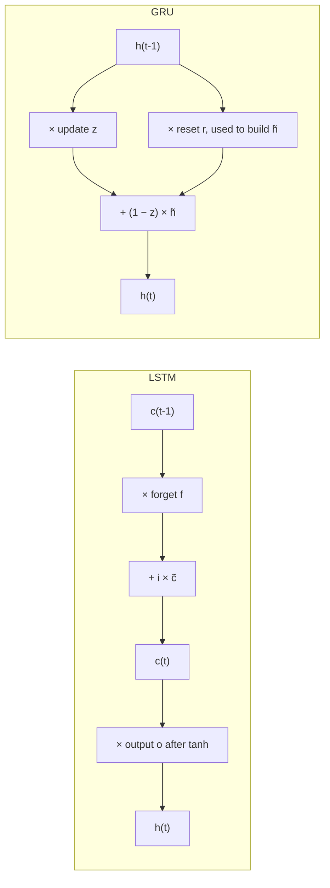

**In simple words:** LSTM and GRU are both RNN cells that use gates (numbers between 0 and 1) to control memory, so they can remember information for a long time. The LSTM has a separate memory line and three gates. The GRU is a simpler design with one memory and two gates.

**Why both exist.** A plain RNN forgets long-ago inputs because its gradients vanish. Both cells fix this by keeping old memory through gates instead of rewriting it. The LSTM came first (1997); the GRU (2014) was designed as a lighter version. <Cite id="hochreiter1997" /> <Cite id="cho2014" />

**LSTM architecture**

1. Two state lines: the **cell state** $c_t$ (long-term memory) and the **hidden state** $h_t$ (output).
2. **Forget gate:** how much old memory to keep.
3. **Input gate** with a tanh **candidate:** how much new information to add.
4. **Output gate:** how much memory to show as $h_t$.

$$
c_t = f_t \odot c_{t-1} + i_t \odot \tilde{c}_t, \qquad h_t = o_t \odot \tanh(c_t)
$$

**GRU architecture** <Cite id="d2l-gru" />

1. One state line: the **hidden state** $h_t$ only.
2. **Reset gate** $r_t$: how much old memory to use when building the candidate $\tilde{h}_t$.
3. **Update gate** $z_t$: keep $z_t$ of the old state and take $1 - z_t$ of the candidate.

$$
h_t = z_t \odot h_{t-1} + (1 - z_t) \odot \tilde{h}_t
$$

Every gate is a sigmoid of the previous hidden state and the current input; $\odot$ is element-wise product. <Cite id="gfdl-ch10" loc="§10.10" />

**Differences**

| Point | LSTM | GRU |
|---|---|---|
| Gates | 3: forget, input, output | 2: update, reset |
| Memory | Separate cell state and hidden state | Hidden state only |
| Keep vs add | Separate forget and input gates | One update gate: keep $z$, add $1 - z$ |
| Output gate | Yes, controls what memory is shown | No, the whole state is output |
| Weight sets | 4 | 3, about 25% fewer parameters |
| Speed | Slower | Faster, less memory |
| Proposed | 1997 (forget gate 2000) | 2014 |
| Best suited to | Very long sequences, large data | Less data, limited compute |

**Similarity.** Both blend old memory into the new state instead of rewriting it, so gradients flow back over many steps. Studies found them similar in accuracy, with neither always better. <Cite id="chung2014" /> <Cite id="gfg-rnn-lstm-gru" />

**Conclusion:** the GRU is a lighter LSTM: fewer gates, no cell state, faster training; the LSTM gives finer control over memory.
