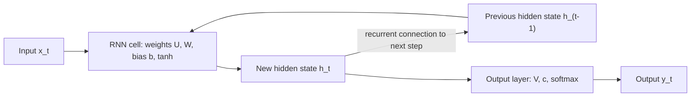

**In simple words:** RNN kuch parts se bana hai: input, hidden state (memory), weights, output, aur wo loop jo har time step par same cell ko repeat karta hai.

**RNN ke key components** <Cite id="class-dl-m5" loc="p. 9" /> <Cite id="class-dl-chp5" loc="slide 7" />

| Component | Ye kya hai | Symbol |
|---|---|---|
| Input | Time $t$ par sequence ka element | $x_t$ |
| Hidden state | Memory: pichhle time steps se aayi information | $h_t$ (previous $h_{t-1}$) |
| Weights aur biases | $U$ (input se hidden), $W$ (hidden se hidden), $V$ (hidden se output), $b$, $c$; **har time step par same** | $U, W, V, b, c$ |
| Activation | Hidden state ko non-linearity deta hai (tanh); output par softmax | $g_1, g_2$ |
| Output | Time $t$ ki prediction | $\hat{y}_t$ |
| Recurrent connection | Loop jo $h_t$ ko agle step tak pahunchata hai; unfold karne par same cell ki chain ban jaati hai | – |

Equations: $h_t = \tanh(U x_t + W h_{t-1} + b)$ aur $\hat{y}_t = \text{softmax}(V h_t + c)$. <Cite id="class-dl-chp5" loc="slide 14" />

**Unfolding:** same RNN cell ko har time step par alag dikhana; weights saare steps mein shared hain. **Learning:** loss nikalta hai, BPTT error ko time mein peeche bhejta hai, aur weights $U, W, V, b, c$ update hote hain. <Cite id="class-dl-chp5" loc="slide 12" /> <Cite id="class-dl-chp5" loc="slide 10" />

**Conclusion:** hidden state aur shared weights RNN ka dil hain; ye kam parameters mein memory dete hain.
