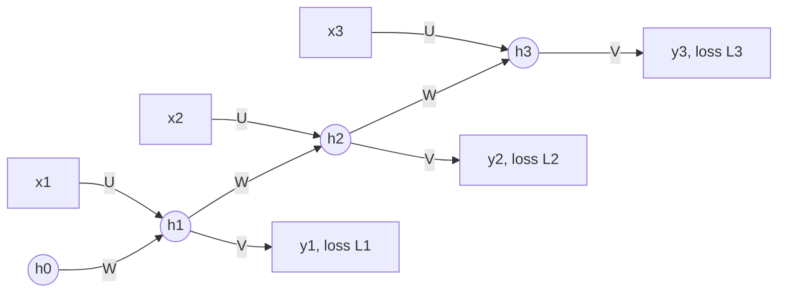

**In simple words:** recurrent neural network (RNN) ek sequence ko ek-ek item karke padhta hai aur jo padha hai uski memory rakhta hai. Iske key components hain: input, hidden state (memory), teen weight sets jo saare time steps mein share hote hain, activations, output aur loss.

**Ye components kyun?** Sequence model ko pehle ke items yaad rakhne hote hain, kisi bhi length ka input lena hota hai, aur har step pe same kaam karna hota hai. Hidden state memory deta hai, aur shared weights ek hi network ko har step handle karne dete hain. <Cite id="gfdl-ch10" loc="§10.2" />

**Components**

1. **Input $x_t$:** time step $t$ pe sequence ka ek element, jaise ek word jo numbers mein badla gaya hai.
2. **Hidden state $h_t$:** ek vector jo network ki memory hai, step $t$ tak dekhi gayi cheezon ka summary. Ye $h_0 = 0$ se shuru hota hai.
3. **Input weights $U$:** decide karte hain ki naya input memory ko kaise badlega.
4. **Recurrent weights $W$:** purani memory ko nayi memory se jodte hain. Yahi loop network ko "recurrent" banata hai.
5. **Output weights $V$:** memory ko output mein badalte hain.
6. **Biases $b$, $c$:** sums ko shift karte hain, jaise kisi bhi neuron mein.
7. **Activations:** hidden state mein tanh (values $-1$ aur $1$ ke beech rakhta hai); output pe classes ke liye softmax, number ke liye kuch nahi.
8. **Output $\hat{y}_t$:** har step pe, ya sirf last step pe (jaise sentiment analysis mein).
9. **Loss:** har output step ka ek loss, jo poori sequence pe jodha jaata hai.

**Ye saath mein kaise kaam karte hain.** Nayi memory = tanh (W gunaa purani memory, plus U gunaa input, plus b). Output = softmax (V gunaa memory, plus c):

$$
h_t = \tanh\left(W h_{t-1} + U x_t + b\right), \qquad \hat{y}_t = \text{softmax}\left(V h_t + c\right)
$$

**Parameter sharing.** Same $U$, $W$, $V$, $b$, $c$ har step pe use hote hain, isliye network kisi bhi length ko handle karta hai aur weights ki sankhya length ke saath nahi badhti. <Cite id="keras-simplernn" />

**Training: BPTT.** RNN ko time pe unfold karke backpropagation through time se train karte hain. Shared weights ke gradients saare steps pe jodte hain. <Cite id="d2l-rnn" />

**Fayde:** koi bhi sequence length, kam parameters, past ki memory. **Limitations:** lambi sequences pe vanishing ya exploding gradients, aur step-by-step processing slow. LSTM aur GRU memory wali problem ko kaafi had tak kam karte hain.

**Applications:** text generation, speech recognition, sentiment analysis, time-series forecasting. <Cite id="gfg-rnn" /> <Cite id="av-rnn" />

**Conclusion.** Recurrent weights wala hidden state, jo time pe shared hai, wahi component hai jisse RNN sequences model karta hai.

Exam mein English mein likho: "An RNN keeps a hidden state that carries information from earlier time steps."
