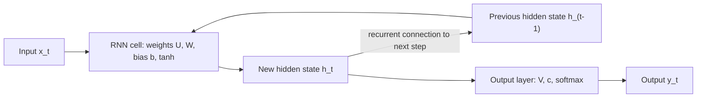

**In simple words:** an RNN is built from a few parts: the input, the hidden state (memory), the weights, the output, and the loop that repeats the same cell at every time step.

**Key components of an RNN** <Cite id="class-dl-m5" loc="p. 9" /> <Cite id="class-dl-chp5" loc="slide 7" />

| Component | What it is | Symbol |
|---|---|---|
| Input | The element of the sequence at time $t$ | $x_t$ |
| Hidden state | The memory: information carried from previous time steps | $h_t$ (previous $h_{t-1}$) |
| Weights and biases | $U$ (input to hidden), $W$ (hidden to hidden), $V$ (hidden to output), $b$, $c$; the **same at every time step** | $U, W, V, b, c$ |
| Activation | Gives the hidden state its non-linearity (tanh); softmax at the output | $g_1, g_2$ |
| Output | The prediction at time $t$ | $\hat{y}_t$ |
| Recurrent connection | The loop that passes $h_t$ to the next step; unfolded it becomes a chain of the same cell | – |

Equations: $h_t = \tanh(U x_t + W h_{t-1} + b)$ and $\hat{y}_t = \text{softmax}(V h_t + c)$. <Cite id="class-dl-chp5" loc="slide 14" />

**Unfolding:** showing the same RNN cell separately at each time step; the weights are shared across all steps. **Learning:** the loss is calculated, BPTT sends the error backward through time, and the weights $U, W, V, b, c$ are updated. <Cite id="class-dl-chp5" loc="slide 12" /> <Cite id="class-dl-chp5" loc="slide 10" />

**Conclusion:** the hidden state and the shared weights are the heart of the RNN; they give memory with few parameters.
